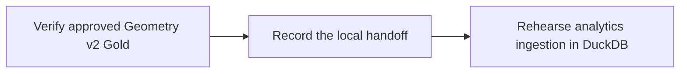

# 07 · Platform Orchestration

**Runtime:** local Dagster with a pinned dependency lock.

**Status:** M1–M4 verified. The automation runs locally, with an explicit
read-only check for releases already ingested by phase 03.

Connect the earlier subprojects into one operable pipeline with scheduling,
dependencies, retries, lineage and recovery. Build this last, after the
individual stages are stable.

## Scope

- Model local release and feature builds as partitioned work. Reuse the
  validated scripts for DuckDB features and containerized MLflow training.
- Detect an approved Gold release by its `_SUCCESS` file and verified
  manifest. Use its release ID to track the BigQuery Iceberg ingestion and
  reconciliation with the existing cloud ledger.
- Add bounded retries, failure alerts and run history. Rerun a failed month
  from its own checkpoint.
- Link every run to its source commit, input data version and output.
- Write and test a recovery runbook for a failed stage.

## Milestones

- **M1.** Verified the local monthly dependency graph with synthetic tests and
  a real November 2024 Gold release.
- **M2.** Verified release detection, ingestion and reconciliation locally.
  The live BigQuery handoff reconciles previously ingested releases read-only.
- **M3.** Orchestrate phase 04 feature builds and the pinned phase 05
  container replay, with checksum-verified reuse.
- **M4.** Verified local failure alerts and stage-only recovery. See the
  [recovery runbook](recovery-runbook.md) and the drill below.

## Acceptance

- A failed stage can be rerun without redoing earlier stages.
- A run record shows inputs, code revision, outputs and quality results.
- Credentials and state stay outside Git.

## Depends on

Projects 03 to 06. The release, feature and model manifests connect the
stages. Projects 01 and 02 supply local inputs.

## Outputs

An orchestrated pipeline, run history and a recovery runbook.

## Local monthly verification



The partition key is a completed UTC month (`YYYY-MM`). `approved_gold`
reuses the phase 04 release validator, verifies the accepted manifest,
payload checksums, approval and `_SUCCESS`, and records label quality.
Dagster persists that result in `FRANKFURT_AIRPORT_STATE_DIR`. `local_handoff` checks
that the verified control files and code are unchanged, then writes a JSON
checkpoint under `FRANKFURT_AIRPORT_STATE_DIR/handoffs`. The checkpoint contains the
release ID, manifest and control hashes, last commit touching the runner,
lock or validator, code hashes and label counts. It is safe to rerun the
handoff with the same inputs.

From this directory:

```bash
uv sync --locked
export FRANKFURT_AIRPORT_RELEASES_DIR=/home/bill/slh-data/full-20241101-20261031-geometry-v2/releases-geometry-v2
work_dir=$(mktemp -d /tmp/frankfurt-airport-orchestration.XXXXXX)
export DAGSTER_HOME="$work_dir/instance"
export FRANKFURT_AIRPORT_STATE_DIR="$work_dir/state"
mkdir -p "$DAGSTER_HOME"
cat > "$DAGSTER_HOME/dagster.yaml" <<'YAML'
telemetry:
  enabled: false
YAML

uv run --locked python -m unittest -v
uv run --locked python orchestration.py verify_month 2024-11
```

Each invocation is a foreground job and records its run ID in the SQLite
instance. Retain both directories to resume the partition. If the handoff
fails, inspect the run, fix the output problem and run the handoff alone:

```bash
uv run --locked python orchestration.py resume_local_handoff 2024-11
```

The handoff retries once and refuses a changed control file or conflicting
checkpoint. If inputs or verification code changed, review the difference
and create a new state directory before reverifying the release.

## M1 verification

Both synthetic tests passed. They verified that `_SUCCESS` is required,
that a changed approval stops recovery, and that a failed handoff can resume
from a new process without materializing the upstream asset again.

The foreground job also verified release `geometry-v2-2024-11`, with 17,051
Gold rows and 13,413 usable labels. A directory temporarily occupied the
handoff path to simulate a write failure. The job retried once and failed.
After that empty directory was removed, `resume_local_handoff` completed
and its repeat produced identical checkpoint bytes. The SQLite event log
recorded one `approved_gold` materialization across all three runs.

| Run | Dagster run ID |
|---|---|
| Write failure | `149594b7-3b38-413a-ab9b-f38d1217419f` |
| Recovery | `256c42d7-f41f-4b14-82b2-1f1a5cc63679` |
| Repeat | `6c6f50c0-67a0-4f57-872c-8e6b383f94b3` |

The run used commit `35ef2bb85bf48c6ff080fa1a5a9e8c95431a8396`.
The handoff SHA-256 was `0eedd7e162db5c8793983425beda39c94b9be5f2d07c06c5a839c53a8ec6e545`.
The instance and checkpoints are local. The drill used no Google Cloud calls.

## M2 release detection and local analytics

The Dagster sensor `geometry_release_ready` detects completed monthly
directories containing all four gate files and proposes a run keyed by
release ID and manifest SHA-256. It defaults to stopped. The job verifies
the full Gold package before publishing a handoff, then checks the pinned
controls again before ingesting. The ingestion asset reuses phase 03's
release verifier and target-table selection. It stages the approved Parquet
in local DuckDB and reconciles total rows, labeled rows and duplicate
`(day_utc, flight_key)` keys. The local table and ledger commit together.

Use a fresh state directory when upgrading from the M1 code. With the
environment configured as above, run the entire path and then replay only
the analytics asset:

```bash
uv run --locked python orchestration.py ingest_month_local 2024-12
uv run --locked python orchestration.py resume_local_analytics 2024-12
```

Both commands print a Dagster run ID, release and manifest identity, rows
added, and reconciliation counts. The database is
`FRANKFURT_AIRPORT_STATE_DIR/analytics.duckdb`. The recovery command uses the existing
handoff. It refuses a changed payload or a mismatch against the ledger and
target table. Each invocation is a foreground process. The local jobs
make no BigQuery or Cloud Storage requests.

### Local verification

The sensor identified 24 completed release partitions. Five integration
tests passed, including the incomplete-release check, stable sensor run
keys and refusal to replay after payload drift or local table corruption.

| Release | Rows | Labeled | Duplicate keys | Rows added on replay |
|---|---:|---:|---:|---:|
| `geometry-v2-2024-12` | 16,218 | 13,079 | 0 | 0 |
| `geometry-v2-2025-01` | 15,033 | 13,089 | 0 | 0 |

The first run added 31,251 rows in total and the ledger recorded two
releases. The replay materialized only the analytics asset. Both months
matched the manifest SHA-256 and counts in the stored phase 03 BigQuery
receipts. Source commit `0f1facc89eef5032bb6237d6a220e151b9279368`.

| Release month | First run | Analytics-only replay |
|---|---|---|
| 2024-12 | `097a782a-fc52-4cf1-b86f-7abba0ee0d9d` | `92f70aa6-754a-4e75-b4b8-f5422067d05a` |
| 2025-01 | `79cb6ea0-f080-4eea-ac3b-386630db9116` | `ea8be018-49a1-497c-acec-52c89e53e58f` |

## M2 read-only BigQuery reconciliation

Use `reconcile_month_bigquery` explicitly for an already-ingested month.
The sensor continues to target the local job. The BigQuery job rechecks the
local handoff and package, then runs a parameterized `SELECT` against the
ingest ledger and Geometry v2 table in `europe-west3`. It accepts exactly
one matching `ingested` ledger record and reconciles the local manifest
hash, total rows, labeled rows and duplicate keys. Missing or inconsistent
evidence fails the job. Each query has a fixed 100 MiB billing cap. The
result records the query job ID and actual bytes billed.

With `bq` authenticated for the project and a fresh state directory as
above, verify the local handoff once and run the read-only asset:

```bash
export FRANKFURT_AIRPORT_BQ_PROJECT=slh-gcp-test
uv run --locked python orchestration.py verify_month 2024-12
uv run --locked python orchestration.py reconcile_month_bigquery 2024-12
```

The existing phase 03 operator workflow owns first-time cloud uploads and
ingestion. This job only reconciles existing releases and reports `rows_added: 0`.

The live check and its repeat matched the 2024-12 manifest and counts:
16,218 rows, 13,079 labeled rows, and zero duplicate keys. Both runs
reported `already_ingested` with zero additions. The first `SELECT` billed
20 MiB. The repeat hit the query cache and billed zero bytes. The local
Dagster instance recorded one upstream verification and two independent
BigQuery reconciliations. Nine tests passed.
[Recorded live evidence](evidence/bigquery-reconciliation-2024-12.json)
retains the job UUIDs. The complete BigQuery job IDs are in the original
Git revision listed in the [project archive notes](../README.md#naming-and-archived-runs).

## M3 feature builds and container replay

`monthly_features` extends each verified Gold handoff with a point-in-time
feature dataset from phase 04. The cache key includes the Gold manifest,
the Silver manifests for the month and preceding UTC day, the feature
code hashes and the five-second simulated availability setting. A cache
hit rechecks the output manifest against those pins and verifies the
output Parquet checksum.

`container_training` depends on the training month and its following
holdout month. The current replay uses November and December 2024. It
checks the two feature manifests and the frozen median baseline report
against the committed phase 05 model release, then invokes that release's
local Docker image with networking disabled. It verifies the model and
both reports against their published SHA-256 values before publishing a
local cache entry. The replay does not register a new model version.

Use a fresh Dagster state directory as in the setup above. The local Docker
daemon must have the image ID recorded in the phase 05 release manifest.
`FRANKFURT_AIRPORT_DOCKER` can name a local alternate executable such as Docker
Desktop's `docker.exe` on WSL. The default is `docker`.

```bash
data_root=/home/bill/slh-data/full-20241101-20261031-geometry-v2
export FRANKFURT_AIRPORT_SILVER_ROOT="$data_root/silver"
export FRANKFURT_AIRPORT_BASELINE_REPORT="$data_root/baselines/geometry-v2-2024-11-median/first/baseline-report.json"

uv run --locked python orchestration.py build_month_features 2024-11
uv run --locked python orchestration.py build_month_features 2024-12
uv run --locked python orchestration.py replay_model_month 2024-11
```

If the feature stage fails after the Gold handoff, use `resume_month_features`
for that month. If training fails, fix the local Docker problem and run
`replay_model_month` again against the same state directory. Feature and
training results report whether a verified cache entry was reused. A bad
checksum fails the run before it can claim reuse.

### M3 verification

The foreground jobs reproduced the pinned November and December feature
manifests, with 8,570 and 8,249 prediction rows respectively. Both feature
repeats returned `reused: true`. An injected Docker startup failure stopped
the training asset. After restoring Docker, rerunning only that asset
reproduced the model, candidate report and frozen evaluation report byte
for byte. A final replay succeeded with the failing Docker executable still
configured, demonstrating checksum-verified reuse without container startup.
All replay containers were removed. The phase 07 suite passed 12 tests.
[Recorded run IDs and hashes](evidence/orchestrated-model-replay-2024-11.json)

## M4 recovery verification

The November 2024 drill used the real approved Gold release, Silver
partitions and pinned Docker image. Four injected failures each produced
one local JSON alert tied to the failed run and its recovery job. A separate
process then recovered only the affected stage, as shown by the Dagster
step history:

| Stage | Injected failure | Recovery check |
|---|---|---|
| Gold handoff | A directory occupied the checkpoint path | One retry before alerting. The recovery used the existing approved Gold asset. |
| Features | Silver input path lacked the required day | The resumed job wrote the same pinned November feature manifest. |
| Local analytics | A directory occupied the DuckDB file path | The resumed load reconciled 17,051 rows and 13,413 labels with zero duplicate keys. |
| Container training | The Docker command failed at startup | The recovered model and both reports matched their published hashes. A repeat used the cache. |

The two distinct months each materialized approved Gold once. The November
handoff hash remained unchanged through the downstream drills. The phase 07
suite passed 12 tests. [Failure alerts, run IDs and hashes](evidence/recovery-drill.json)

The local daemon also exercised the release sensor against the January 2025
Gold package. The first tick submitted one run and reconciled 15,033 rows,
13,089 labels and no duplicate keys in DuckDB. The next tick skipped the
same run key and submitted zero runs. The temporary sensor was stopped and
the daemon exited afterward. [Sensor run evidence](evidence/sensor-drill.json)
