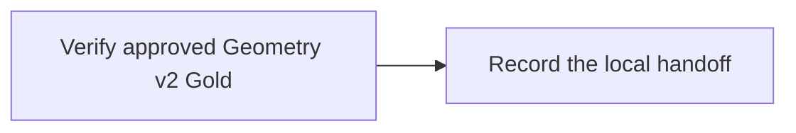

# 07 · Platform Orchestration

**Runtime:** local Dagster with a pinned dependency lock.

Connect the earlier subprojects into one operable pipeline with scheduling,
dependencies, retries, lineage and recovery. Build this last, after the
individual stages are stable.

## Scope

- Model local release and feature builds as partitioned work. Reuse the
  validated scripts for DuckDB features and containerized MLflow training.
- Detect an approved Gold release by its `_SUCCESS` file and verified
  manifest. Use its release ID to track the BigQuery Iceberg ingestion and
  reconciliation with the existing cloud ledger.
- Add bounded retries, failure alerts and run history. Rerun a failed month
  from its own checkpoint.
- Link every run to its source commit, input data version and output.
- Write and test a recovery runbook for a failed stage.

## Milestones

- **M1.** Verified the local monthly dependency graph with synthetic tests and
  a real November 2024 Gold release.
- **M2.** Orchestrate release detection, ingestion and analytics load end to
  end.
- **M3.** Add feature build and training.
- **M4.** Failure injection, recovery exercise and runbook.

## Acceptance

- A failed stage can be rerun without redoing earlier stages.
- A run record shows inputs, code revision, outputs and quality results.
- Credentials and state stay outside Git.

## Depends on

Projects 03 to 06. The release, feature and model manifests connect the
stages. Projects 01 and 02 supply local inputs.

## Outputs

An orchestrated pipeline, run history and a recovery runbook.

## Local monthly verification



The partition key is a completed UTC month (`YYYY-MM`). `approved_gold`
reuses the phase 04 release validator, verifies the accepted manifest,
payload checksums, approval and `_SUCCESS`, and records label quality.
Dagster persists that result in `FRAPORT_STATE_DIR`. `local_handoff` checks
that the verified control files and code are unchanged, then writes a JSON
checkpoint under `FRAPORT_STATE_DIR/handoffs`. The checkpoint contains the
release ID, manifest and control hashes, last commit touching the runner,
lock or validator, code hashes and label counts. It is safe to rerun the
handoff with the same inputs.

From this directory:

```bash
uv sync --locked
export FRAPORT_RELEASES_DIR=/home/bill/slh-data/full-20241101-20261031-geometry-v2/releases-geometry-v2
work_dir=$(mktemp -d /tmp/fraport-orchestration.XXXXXX)
export DAGSTER_HOME="$work_dir/instance"
export FRAPORT_STATE_DIR="$work_dir/state"
mkdir -p "$DAGSTER_HOME"
cat > "$DAGSTER_HOME/dagster.yaml" <<'YAML'
telemetry:
  enabled: false
YAML

uv run --locked python -m unittest -v
uv run --locked python orchestration.py verify_month 2024-11
```

Each invocation is a foreground job and records its run ID in the SQLite
instance. Retain both directories to resume the partition. If the handoff
fails, inspect the run, fix the output problem and run the handoff alone:

```bash
uv run --locked python orchestration.py resume_local_handoff 2024-11
```

The handoff retries once and refuses a changed control file or conflicting
checkpoint. If inputs or verification code changed, review the difference
and create a new state directory before reverifying the release. The current
jobs read Gold locally. M2 will connect the checkpoint to analytics ingestion.

## M1 verification

Both synthetic tests passed. They verified that `_SUCCESS` is required,
that a changed approval stops recovery, and that a failed handoff can resume
from a new process without materializing the upstream asset again.

The foreground job also verified release `geometry-v2-2024-11`, with 17,051
Gold rows and 13,413 usable labels. A directory temporarily occupied the
handoff path to simulate a write failure. The job retried once and failed.
After that empty directory was removed, `resume_local_handoff` completed
and its repeat produced identical checkpoint bytes. The SQLite event log
recorded one `approved_gold` materialization across all three runs.

| Run | Dagster run ID |
|---|---|
| Write failure | `149594b7-3b38-413a-ab9b-f38d1217419f` |
| Recovery | `256c42d7-f41f-4b14-82b2-1f1a5cc63679` |
| Repeat | `6c6f50c0-67a0-4f57-872c-8e6b383f94b3` |

The run used commit `35ef2bb85bf48c6ff080fa1a5a9e8c95431a8396`.
The handoff SHA-256 was `0eedd7e162db5c8793983425beda39c94b9be5f2d07c06c5a839c53a8ec6e545`.
The instance and checkpoints are local. The drill used no Google Cloud calls.
