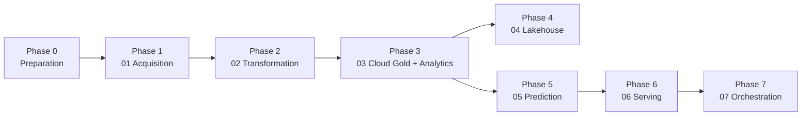

# Project plan

Plan for the Fraport ADS-B Intelligence programme. Durations are rough
estimates for one person working part-time. Replace them with measured
values after the first phase.

Architecture in one line: **local Bronze and Silver, a governed Gold release,
then cloud Gold, analytics and models.** See
[ADR-003](adr/ADR-003-local-bronze-silver-published-gold.md).

## Overview



| Phase | Subproject | Runtime | Estimate |
|-------|------------|---------|----------|
| 0 | Preparation | Local | 1 week |
| 1 | 01 OpenSky Acquisition | Local | 4 to 6 weeks |
| 2 | 02 Aviation Transformation | Local | 4 to 5 weeks |
| 3 | 03 Airport Analytics | GCP | 4 to 5 weeks |
| 4 | 04 Lakehouse Integration | Databricks | 3 to 4 weeks |
| 5 | 05 Taxi-in Prediction | Vertex AI | 4 to 5 weeks |
| 6 | 06 Model Serving | Cloud Run | 2 to 3 weeks |
| 7 | 07 Orchestration | GCP Workflows or Dagster | 3 to 4 weeks |

Phases 4 and 5 can run in parallel after phase 3.

## Vertical slice V0

Do not wait for the full backfill before the layers meet. Once the pilot week
of phase 1 is accepted, push that week through every layer. It runs in
parallel with the monthly batches, which are mostly waiting time.

```text
pilot week -> Silver -> Gold -> release v001 -> cloud ingestion -> BigQuery query
```

| Step | Subproject | Exit criterion |
|------|------------|----------------|
| Silver and Gold for the pilot week | 02 M1, M2 | Tests pass, coverage report written |
| Data contract and Release Gate | 02 M3 | `v001` released, a failing fixture blocked |
| Table-format spike | 03 M1 | Result recorded in ADR-004 |
| Cloud foundation | 03 M2 | Terraform applies, CI runs plan |
| Ingest synthetic release, then `v001` | 03 M3 | Repeat ingestion adds no rows |

**Exit:** the first real release is ingested in the cloud, the idempotence
check passes, and a first query reconciles with the release manifest. Only
after this do phases 2 to 3 scale up to the full dataset.

## Phase 0: Preparation

- Confirm OpenSky account, Trino access and query limits.
- Decide the geographic bounds and fields for dataset `v1`.
- Accept ADR-001 to ADR-003.
- Create the data root outside the repository and check free disk space.
- Add the `.gitignore` rules that keep data and credentials out of Git.

**Exit:** access confirmed, ADRs accepted.

## Phase 1: 01 OpenSky Acquisition

Scope: dataset `eddf_r75km` v1, 75 km region, `[2024-11-01, 2026-11-01)`,
24 monthly batches. See the [design](../01-opensky-acquisition/docs/design.md)
and the [batch plan](../01-opensky-acquisition/docs/batch-plan.md).

| Milestone | Content | Exit criterion |
|-----------|---------|----------------|
| M0 | Skeleton: config, schema, manifest, state, fake client, CLI shell | Unit tests pass |
| M1 | Collect and commit protocol against the fake client | Crash-injection and repeat-run tests pass |
| M2 | Live pilot: one hour, one day, one week | Gate G0: reconciled, cross-checked, measured, recovery tested |
| M3 | Monthly batches with reports, acceptance and backup | Each batch accepted and backed up |
| M4 | Manifest export and DuckDB catalog | Accepted hours readable through the catalog |
| M5 | Dataset sign-off | Full verify, dataset summary, backup restore tested |

**Status (2026-11-16):** M0 to M2 are done. Batches b01 (2026-10) through b07
(2026-06) are collected, validated, accepted and backed up. Next is M3 batch
b08 (2026-05). The working list is the
[acquisition status](../01-opensky-acquisition/README.md#status-2026-11-16).
Vertical slice V0 (Silver for the pilot week) can start in parallel. It is
not the next acquisition step.

CI: tests and lint on pull requests that touch this directory.
Bronze is not uploaded to the cloud.

## Phase 2: 02 Aviation Transformation

Local Silver, Gold and Release Gate with Python and DuckDB.

1. Silver for one day, with tests (pilot week).
2. Gold features and labels with a label coverage report.
3. Data contract, field policy and Release Gate. Release `v001` and a blocked
   failing fixture.
4. Synthetic data generator in the same schema.
5. Full dataset run with run ID, quality report and repeat-run result.
6. Container image and CI.

**Exit:** reproducible Silver and Gold output and an immutable, verified
release.

## Phase 3: 03 Airport Analytics and cloud Gold

1. Spike for the table format and catalog (ADR-004).
2. Terraform for Landing, Gold storage, identities and budget alerts, with CI.
3. Release ingestion, idempotent, tables carrying the release ID.
4. Analytics model and core queries with expected results.
5. Full dataset release, cost record and findings.

**Exit:** reconciled tables, documented grain, idempotent ingestion and a
findings report.

## Phase 4: 04 Lakehouse Integration

1. Schema mapping and Cloud Storage access from Databricks.
2. One release through Bronze, Silver and Gold in the Databricks project.
3. Feature contract with project 05.

**Exit:** reproducible Gold features with reported label coverage.

## Phase 5: 05 Taxi-in Prediction

1. Label definition and coverage.
2. Baselines on a time-ordered split.
3. Gradient-boosted model with experiment tracking.
4. Vertex AI training job and model registration.
5. Evaluation report.

**Exit:** versioned model, traceable to a release ID, and an honest comparison
against the baseline.

## Phase 6: 06 Model Serving

1. Contract tests with synthetic requests.
2. Local container with a pinned model version.
3. Cloud Run deployment through CI/CD.
4. Monitoring and a tested rollback.

**Exit:** deployed endpoint traceable to a model version and commit.

## Phase 7: 07 Platform Orchestration

1. ADR comparing Workflows and Dagster.
2. Orchestrate release detection, ingestion and analytics.
3. Add features and training.
4. Failure injection and recovery runbook.

**Exit:** a failed stage reruns without redoing earlier stages.

## Programme acceptance

| Capability | Criterion |
|------------|-----------|
| Reliability | Repeating a run or a release ingestion creates no duplicates |
| Data quality | Schema, row counts, checksums and business rules pass checks |
| Governance | A release that fails its contract is blocked from upload |
| Reproducibility | A release ID and a table snapshot reproduce a model input |
| Portability | A fork runs the full flow with synthetic data in its own GCP project |
| Security | The cloud cannot read local Bronze or Silver. Upload and runtime identities are separate |
| Observability | Failed jobs, durations, data volume and cost are visible |
| Cost control | Budget alerts exist and compute runs on demand |

## Cross-cutting work

- **CI.** Each subproject has its own path-scoped checks.
- **Infrastructure as code.** Terraform for every cloud resource, created in
  phase 3 and reused later. No state files or secrets in Git.
- **Documentation.** Each subproject keeps its README current, adds
  architecture and runbook pages when needed and records decisions as ADRs.
- **Evidence.** Record commit, run ID, data version, release ID and quality
  results for each milestone.
- **Cost.** Track observed cloud cost from phase 3 onward.
- **Data governance.** Keep raw data out of Git and out of public storage.
  Only Gold releases go to the cloud.

## Risks

| Risk | Impact | Mitigation |
|------|--------|------------|
| OpenSky Trino limits or downtime | Slow or incomplete backfill | Hourly batches, retries, resumable checkpoint |
| Collection is interrupted | Incomplete dataset | Run the most valuable months first, back up each batch when accepted |
| Data volume above estimate | Disk shortage | Seven-day size test before the full backfill |
| Proxy labels are noisy | Weak model or overclaimed results | Report coverage, validate a sample independently |
| Gold too coarse for the model | The cloud cannot train a per-flight model | Gold contract requires per-flight features and labels from the start |
| Table format unverified | Rework of cloud tables | Time-boxed spike and ADR-004 before cloud table code, native tables as fallback |
| Layers meet late | Integration surprises after weeks of work | Vertical slice V0 on the pilot week |
| Scope growth | Programme stalls | Finish each phase exit criterion before starting the next |
| Overlap with existing aviation projects | Duplicate work | Subprojects 04 and 06 link to them and own only integration |

## Open decisions

- Final geographic bounds and the field list for `v1`.
- Field policy for `icao24` and `callsign` in Gold releases: keep, hash or
  drop.
- Gold table format and catalog, decided by the ADR-004 spike.
- GCP Workflows or Dagster for phase 7.
- Cloud region for the bucket and BigQuery, checked against service support.
