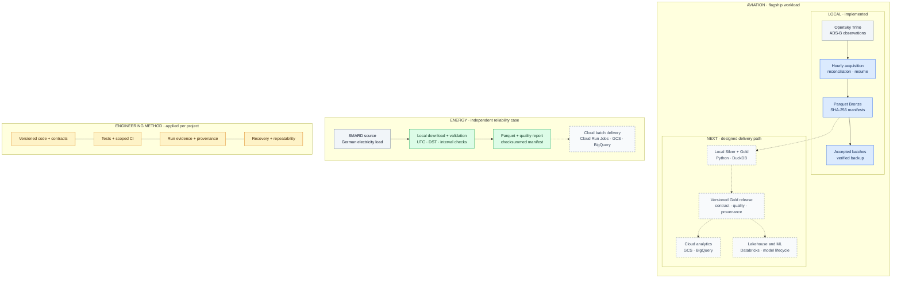

# SoloLakehouse

<!-- [Codex · 2026-11-13] Initial platform and project layout. -->
<!-- [Codex · 2026-11-13] Named projects and milestones. -->
<!-- [Codex · 2026-11-13] Project positioning and domain navigation. -->
<!-- [房玄龄·2026-11-15] Document the OpenSky pilot, batch development and current project layout. -->

<!-- [房玄龄·2026-11-17] Align the public overview with Data/AI Platform Engineering and current implementation evidence. -->
<!-- [房玄龄·2026-11-17] Explain the reference architecture, delivery boundaries and current evidence. -->

**Building trustworthy data and AI platforms for complex operational domains.**

SoloLakehouse is a personal Data & AI platform engineering reference. Its
flagship aviation workload turns incomplete aircraft observations around
Frankfurt Airport (FRA / EDDF) into traceable, recoverable local datasets. An
independent German energy workload tests source verification and time
semantics. Each project has its own delivery path; the repository brings
together the engineering methods, code and evidence used to build them. The
architecture is organized around Data/AI Platform Engineer responsibilities:
ingestion, data contracts, quality, reproducibility and operational recovery.

The central questions are practical: **What does the source observation mean?
Can this output be trusted? What happens when a run fails or is repeated?**
Contracts, quality reports, manifests, tests and recovery checks make those
answers reviewable. Current implementations run locally. Google Cloud and
Databricks projects describe later delivery stages, not a deployed shared
platform.

**Start here:** [Aviation implementation](Fraport-adsb-intelligence/01-opensky-acquisition/README.md)
· [Measured benchmark](Fraport-adsb-intelligence/01-opensky-acquisition/docs/benchmark-report.md)
· [Energy implementation](gcp/01-european-energy-pipeline/README.md)

## Architecture at a glance



Solid arrows show implemented data paths. Dashed arrows show proposed handoffs
or planned work; they are not evidence of a running integration. Aviation raw
data and Bronze stay local. The [aviation design](Fraport-adsb-intelligence/docs/adr/ADR-003-local-bronze-silver-published-gold.md)
proposes local Silver and Gold, then a checked, immutable Gold release as the
boundary for cloud consumers. The energy project has its own local output and
future GCP route. There is no shared production runtime behind these lanes.

The same engineering method is applied within each project: define source
meaning and output contracts, validate before accepting a result, record the
source and code revision, and prove what a rerun or interruption does. Git
versions code, contracts, configuration, tests and architecture decisions;
credentials, raw research data and runtime state stay outside this repository.

| Delivery boundary | Implemented now | Designed next |
|---|---|---|
| Aviation | Local OpenSky acquisition, reconciliation, Parquet manifests, accepted batches and verified backup | Local Silver/Gold, versioned release, cloud analytics and model integration |
| Energy | Local SMARD download, UTC normalization, Parquet, quality report, manifest and scoped CI | Cloud Run Jobs, GCS and BigQuery delivery |
| Self-hosted lakehouse | [Historical implementation in a pinned snapshot](https://github.com/Jiahong-Que-9527/SoloLakehouse/tree/741e6da82cdc2cad207aa6ee707b8fb157b0174a) | Reproduce a fixture flow; evaluate K3s and GitOps later |

## Engineering capabilities and evidence

| Capability | What this repository demonstrates | Review |
|---|---|---|
| Reliable ingestion | Hourly collection, manifest-based commits, interruption recovery and repeat runs that preserve committed outputs | [Acquisition code](Fraport-adsb-intelligence/01-opensky-acquisition/src/opensky_ingest/) · [Recovery and rerun tests](Fraport-adsb-intelligence/01-opensky-acquisition/tests/test_run.py) |
| Data quality and semantics | Source reconciliation; separate empty, missing and failed partitions; explicit schemas; timezone-aware interval validation | [Aviation validation](Fraport-adsb-intelligence/01-opensky-acquisition/src/opensky_ingest/validate.py) · [Energy normalization tests](gcp/01-european-energy-pipeline/tests/test_normalize.py) |
| Traceability and recovery | SHA-256 manifests, source revision metadata, batch reports and verified copies to a second disk | [Acquisition design](Fraport-adsb-intelligence/01-opensky-acquisition/docs/design.md) · [Backup implementation](Fraport-adsb-intelligence/01-opensky-acquisition/src/opensky_ingest/publish.py) |
| Repeatable delivery | Locked Python environments, synthetic tests, CLI interfaces and project-scoped energy CI | [Energy workflow](.github/workflows/energy-pipeline.yml) · [Energy CLI tests](gcp/01-european-energy-pipeline/tests/test_cli.py) |
| Architecture and tradeoffs | Workload placement, raw-data boundaries, regional extraction and staged cloud integration | [Aviation architecture decisions](Fraport-adsb-intelligence/docs/adr/) · [Energy design](gcp/01-european-energy-pipeline/docs/design.md) |

**Current implementation tools:** Python 3.12+, OpenSky's remote Trino source,
PyArrow / Parquet, SQLite, pytest, Ruff, uv and GitHub Actions for the energy
project. DuckDB, GCP and Databricks appear in the next-stage designs above;
their presence in the roadmap does not establish a running integration.

## Flagship: Frankfurt aviation data foundation

[Fraport ADS-B Intelligence](Fraport-adsb-intelligence/README.md) starts with
[OpenSky Acquisition](Fraport-adsb-intelligence/01-opensky-acquisition/README.md).
The Python CLI collects hourly ADS-B state vectors and daily flight records
from OpenSky Trino, writes Parquet with checksummed manifests, and resumes
from the last committed hour.

Historical ADS-B feeds contain source gaps and processing changes. A useful
foundation for later airport analytics must preserve those distinctions and
survive partial downloads without silently treating incomplete data as complete.

### Recorded results

The [acquisition status dated 2026-11-16](Fraport-adsb-intelligence/01-opensky-acquisition/README.md#status-2026-11-16)
records:

- **15 monthly batches accepted and backed up**, covering August 2025
  through October 2026. October 2026 alone contains **109,641,931 state-vector
  rows** and **40,844 flight records**.
- **168/168 pilot hours matched source aggregates**, with a separate
  168/168 match against legacy receipts for the smaller airport region.
- **Recovery verified at the file/manifest boundary.** A deliberately
  interrupted hour was recollected with the same SHA-256; the following
  repeat run preserved the day's manifests.

The [five-day benchmark](Fraport-adsb-intelligence/01-opensky-acquisition/docs/benchmark-report.md)
records **3.86 million rows, 75.1 MB of Parquet and 95 seconds of combined
query/download time** for its busiest sampled day, with **733 MB peak process
memory**. These are local collection measurements against remote Trino.

Raw datasets and detailed batch receipts remain outside Git. The public
repository provides implementation, tests and written result summaries.

### Design decisions worth reviewing

- **Commit through manifests.** Resume from committed hours and quarantine
  orphaned files after an interruption. Keep source gaps, empty regional
  results and collection failures distinct.
- **Measure before expanding.** Benchmark across seasons and back up each
  accepted month. An A/B test found that retaining `serials` increased Parquet
  size to 1.57× and query/download time to 1.76×; v1 excludes that column.
  [Batch plan and A/B result](Fraport-adsb-intelligence/01-opensky-acquisition/docs/batch-plan.md)
- **Place workloads deliberately.** Historical collection runs locally with
  a second-disk backup. The planned downstream path builds Silver and Gold
  locally, then publishes approved, versioned Gold for cloud consumers.
  [Project plan](Fraport-adsb-intelligence/docs/project-plan.md)

This is an independent engineering and research project. ADS-B-derived taxi-in
labels are proxies requiring independent validation against airport ground
truth. Transformation, cloud analytics, modeling and serving are planned stages.

## Second case: German energy data reliability

[European Energy Pipeline](gcp/01-european-energy-pipeline/README.md) implements
a bounded SMARD downloader and a local CSV-to-Parquet pipeline for German
actual total load. It addresses a different failure pattern: local timestamps
repeat or disappear at daylight-saving time boundaries.

- **Time semantics:** normalize 15-minute MWh observations to UTC, with tests
  for 92-interval spring days and 100-interval autumn days. Missing,
  duplicate or out-of-order intervals fail validation.
- **Source handling:** verify cached bytes, persist access-denial and cooldown
  state, bound retries, and retain source attribution and retrieval time.
- **Reproducibility:** emit Parquet, a quality report and a checksummed
  manifest with code revision metadata. Invalid data produces a failure
  report without publishing Parquet.
- **Recorded live check, 2026-11-17:** one historical day produced 96 valid
  intervals. A cached rerun needed no source requests and produced the same
  Parquet checksum. [Verification report](gcp/01-european-energy-pipeline/docs/download-verification.md)

The [project-scoped CI workflow](.github/workflows/energy-pipeline.yml) runs
pytest and Ruff using synthetic inputs and fake HTTP responses. Cloud Storage,
BigQuery, Cloud Run Jobs and Terraform deployment remain planned.

## Run the checks locally

With Python 3.12+ and uv installed, run from the repository root:

```bash
# Aviation: synthetic sources; no OpenSky login or raw dataset required.
cd Fraport-adsb-intelligence/01-opensky-acquisition
uv sync --locked
uv run --locked pytest

# Energy: synthetic intervals and fake HTTP responses.
cd ../../gcp/01-european-energy-pipeline
uv sync --locked
uv run --locked pytest
uv run --locked ruff check .
uv run --locked ruff format --check .
```

Dependency installation needs package access. The tests require no cloud
account or live source access; two optional energy real-data tests skip when
local CSV exports are absent. Each project README documents the operational CLI.

## Project status and navigation

| Area | Current status | Next delivery |
|---|---|---|
| [Aviation acquisition](Fraport-adsb-intelligence/01-opensky-acquisition/README.md) | Implemented locally; 15 accepted monthly batches recorded as of 2026-11-16 | Continue the two-year backfill; build local Silver / Gold |
| [Energy pipeline](gcp/01-european-energy-pipeline/README.md) | Local downloader, normalization, tests and CI implemented | Cloud Run Jobs, Cloud Storage and BigQuery delivery |
| [Aviation lakehouse](Fraport-adsb-intelligence/04-aviation-lakehouse/README.md) and [model serving](Fraport-adsb-intelligence/06-model-serving/README.md) | Project briefs and designs | Consume versioned Gold in Databricks; later serve a pinned model on Cloud Run |
| [Finance](databricks/01-ecb-delta-lakehouse/README.md) | Project briefs in the current layout | ECB Silver / Delta Lakehouse workloads |
| [Self-hosted lakehouse](local/self-hosted-lakehouse/README.md) | Historical implementation in a [pinned snapshot](https://github.com/Jiahong-Que-9527/SoloLakehouse/tree/741e6da82cdc2cad207aa6ee707b8fb157b0174a) | Reproduce a fixture flow; evaluate K3s and GitOps at a later milestone |

Further navigation: [Aviation plan](Fraport-adsb-intelligence/docs/project-plan.md)
· [Engineering roadmap](docs/roadmap.md)
· [Google Cloud projects](gcp/README.md)
· [Databricks projects](databricks/README.md)
· [Project template](project-template/README.md)
