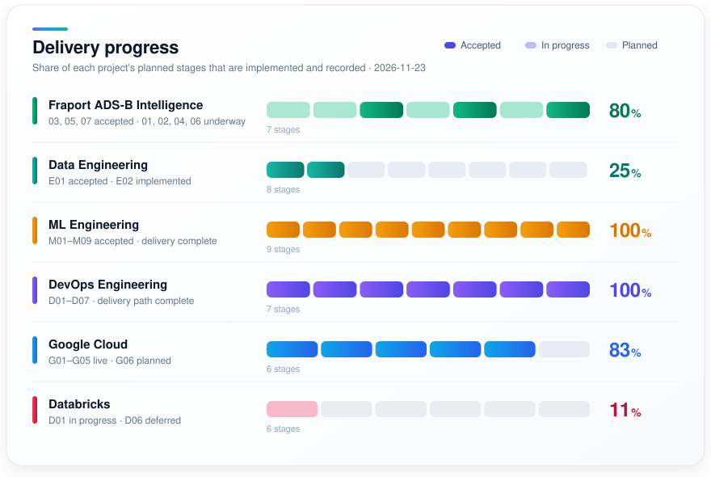

# SoloLakehouse

SoloLakehouse is a personal portfolio of independent **Data and AI platform engineering** projects. It covers the full path a data product travels: reliable ingestion from imperfect sources, validated and versioned datasets, delivery on managed cloud services, and the DevOps practice that ships, observes and recovers all of it. Each project owns its inputs, environment and acceptance checks, and records the evidence behind every claim.


## Projects

| Project | Question it answers | What is built | Evidence / status |
|---|---|---|---|
| [**Fraport ADS-B Intelligence**](Fraport-adsb-intelligence/README.md) | Can **incomplete aircraft observations** around Frankfurt Airport support **reproducible analysis**? | Local OpenSky collector with **checksummed manifests** and **resumable runs**; **DuckDB** Silver and Gold layers; versioned releases through a **Release Gate** that blocks failing data | **54%** · **44 monthly batches** accepted and backed up through 2023-03. The October 2026 batch contains **109.6M rows**, and a recollected hour matched its original SHA-256. **03 M5 accepted** with 24 Geometry v2 releases reconciled in BigQuery (**433,694 candidates**, **92.4%** label coverage). **04** replayed November and December features with simulated observation availability. The November replay produced **8,570 predictions** and **7,607 usable labels**. **05 M4 complete** with an offline Docker replay and local MLflow version 1. December MAE improved from **148.6 s to 137.5 s**. Cross-season evaluation is next. |
| [**Data Engineering**](Data-engineering/README.md) | Can a **hybrid EV-charging and roaming** workload be delivered as a governed warehouse on **dbt, DuckDB, BigQuery and Airflow**? | Resumable raw ingestion, **Kimball** marts, dbt tests and contracts, incremental **SCD Type 2**, Slim CI, BigQuery FinOps, local **Airflow** | **5%** · Architecture, contracts and implementation plans are ready for **E01–E08**. **E01** ingestion is underway locally with locked German open-data fixtures, deterministic generator, quarantine/resumable CLI and tests in progress (acceptance pending). |
| [**ML Engineering**](Mlops-engineering/README.md) | Can one ML system be **closed end to end**, from features to **drift-triggered retraining**? | **Point-in-time features**, rolling backtests, **MLflow** lineage, release gate, batch and online serving, drift monitoring, **Dagster** | **100%** · **M01–M09 accepted** — the system is closed end to end. The gradient-boosted model reached **6.35 kWh MAE** over 23 folds (vs **7.69 kWh** for the median and **9.15 kWh** for the naive baseline), with MLflow lineage, a pinned release, tested rollback, HTTP serving, verified drift alerts and deterministic Dagster retraining replay with failed-day recovery. **M09** proved the platform: the template extracted from what runs and the `district-forecast` second workload onboarded through it — its own contracts, baselines, release manifest and model card, pooled MAE **22.34 kWh** vs **30.98/33.63** baselines — without touching the first workload. |
| [**DevOps Engineering**](Devops-engineering/README.md) | How does a service travel from a **source change** to a **verified deployment**, and recover from a bad release? | **Seven stages:** reproducible dev, containers, **CI** with supply-chain checks, **digest rollback**, **Kubernetes GitOps** drills, incident recovery, reusable template | **100%** · **D01–D07 accepted** with recorded delivery and recovery drills. D01–D02 were verified on a fresh GitHub checkout on 2026-11-22, and the template onboarded a second service. |
| [**Google Cloud**](gcp/README.md) | How are **data products** delivered and governed on managed cloud services? | Scheduled **Cloud Run** batch job to **Cloud Storage and BigQuery**; authenticated **API** over an authorized view; **Pub/Sub** event processing with dedup and replay; governed release with contracts | **70%** · **G01–G04 verified live** with zero destroys. Repeated annual exports matched by checksum, and the first governed release passed a live block, withdrawal and republish drill. **G05** has completed step 1 of 5 (pinned fixture, MW target and dataset validation). **G06** is planned. |
| [**Databricks**](databricks/README.md) | How does a **governed lakehouse** product run on Databricks? | **Delta** tables, scheduled jobs, **CDC** with corrections, **Unity Catalog**, MLflow forecasting, workspace provisioning | **11%** · **D01** has local fixtures, unit tests and a CLI bundle. The Free Edition workspace verification is pending. **D02–D05** are planned and **D06** is deferred on Free Edition. |

## Delivery progress



Progress estimates combine accepted stages and documented partial work across each project's roadmap.

The earlier self-hosted lakehouse (Compose, Dagster, Iceberg, Trino) is preserved in a [pinned snapshot](https://github.com/Jiahong-Que-9527/SoloLakehouse/tree/741e6da82cdc2cad207aa6ee707b8fb157b0174a); a fixture reproduction is a later milestone.

## Capabilities and target roles

| Project | What it shows | Target roles |
|---|---|---|
| Fraport ADS-B Intelligence | **Resumable bulk ingestion**, **manifest commits**, data quality semantics, **DuckDB** Silver and Gold modelling, **data contracts** and **release gates** | **Data Engineer** · **Data Platform Engineer** |
| DevOps Engineering | **Docker**, **GitHub Actions**, image **supply-chain checks**, **digest-based rollback**, **k3d and Helm GitOps**, **observability**, incident drills, service templates | **DevOps Engineer** · **Platform Engineer** · **SRE** |
| Google Cloud | **Cloud Run**, **BigQuery**, **Pub/Sub**, **Terraform**, **Workload Identity Federation**, authorized views, **idempotent event processing**, governed data products | **Cloud Data Engineer** · **Backend Engineer (data)** |
| Data Engineering *(in progress)* | **dbt**, **DuckDB**, **BigQuery**, **Airflow**, data contracts, incremental SCD | **Data Engineer** |
| ML Engineering *(in progress)* | **Point-in-time features**, evaluation, **model registry**, **drift monitoring**, orchestration | **MLOps Engineer** · **ML Engineer** |
| Databricks *(in progress)* | **Delta**, **Jobs**, **CDC**, **Unity Catalog**, workspace provisioning | **Lakehouse Engineer** |

A capability counts as demonstrated only where the repository holds code, tests and recorded evidence.

## Run the checks

With Python 3.12+ and [uv](https://docs.astral.sh/uv/). Tests use synthetic data and need no cloud account or live source.

```bash
cd Fraport-adsb-intelligence/01-opensky-acquisition   # or gcp/01-european-energy-pipeline
uv sync --locked && uv run --locked pytest
```

Raw datasets, credentials and runtime state stay outside Git; the repository holds code, contracts, designs and evidence summaries.

[Engineering roadmap](docs/roadmap.md) · [Aviation plan](Fraport-adsb-intelligence/docs/project-plan.md) · [Project template](project-template/README.md)
