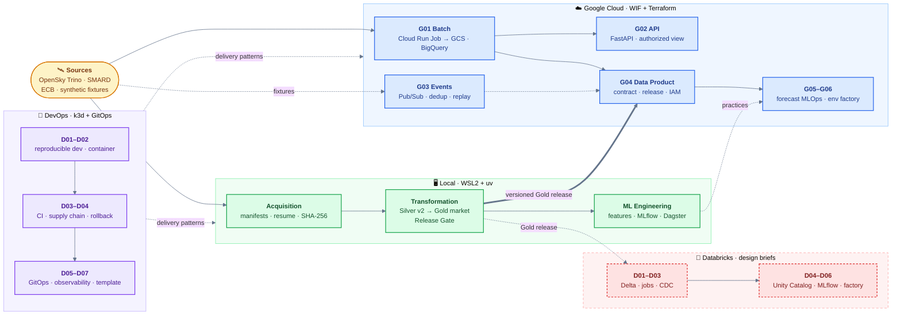

# SoloLakehouse

<!-- [Codex · 2026-11-13] Initial platform and project layout. -->
<!-- [Codex · 2026-11-13] Named projects and milestones. -->
<!-- [Codex · 2026-11-13] Project positioning and domain navigation. -->
<!-- [房玄龄·2026-11-15] Document the OpenSky pilot, batch development and current project layout. -->

<!-- [房玄龄·2026-11-17] Align the public overview with Data/AI Platform Engineering and current implementation evidence. -->
<!-- [房玄龄·2026-11-17] Explain the reference architecture, delivery boundaries and current evidence. -->

<!-- [房玄龄·2026-11-17] Map the flagship cases and platform series. -->

SoloLakehouse is a personal portfolio of independent Data and AI platform engineering projects. Two flagship cases approach platform work from different directions. **Fraport ADS-B Intelligence** follows operational data from source observation to an accepted dataset. **DevOps Engineering** follows a software service from a fresh checkout to release, recovery and reuse. The **Google Cloud** and **Databricks** series explore how to deliver data products on each platform through six scoped cases apiece.

## Portfolio architecture




Solid boxes are implemented or in delivery; dashed borders are design briefs. Arrows show data and release flow; dotted arrows show reused patterns.

Each project specifies its own inputs, environment and acceptance checks. Git versions code, contracts, designs and evidence summaries. Raw research data, credentials and runtime state stay with their owners.

## Two flagship cases

**Fraport ADS-B Intelligence** asks whether incomplete aircraft observations around Frankfurt Airport can support reproducible analysis. Its implemented WSL collector reconciles hourly observations, commits Parquet partitions through manifests and resumes interrupted runs. Its planned stages derive local Silver and Gold datasets, publish a versioned Gold release, and use that release for analytics, taxi-in prediction and model serving. The release contract defines what future consumers can rely on. [Case overview](Fraport-adsb-intelligence/README.md) · [Architecture decision](Fraport-adsb-intelligence/docs/adr/ADR-003-local-bronze-silver-published-gold.md)

**DevOps Engineering** asks how a developer can trace a service from a source change to a verified deployment and recover it after a bad release. Its own reference service reads synthetic electricity-meter audit reports. Its seven planned stages progress from reproducible development and containers through CI and image publication, release and rollback, Kubernetes and GitOps, observability and incident recovery, then onboarding a second service from a reusable template. D01 is the first implementation milestone. Inputs, release assets and acceptance evidence belong to this case. [Delivery roadmap](Devops-engineering/README.md) · [Reference service](Devops-engineering/reference-service/README.md)

## Two platform series

**Google Cloud** uses German electricity-load data as its main workload. G01 already downloads SMARD data, validates time intervals and reproduces annual Parquet locally. Its cloud milestone is a scheduled Cloud Run Job with Cloud Storage and BigQuery. The subsequent cases each define a separate delivery target. [Google Cloud series](gcp/README.md)

**Databricks** uses financial time series and corrections to explore the lifecycle of a governed lakehouse product. The six projects are design briefs with proposed acceptance checks. Their route runs from versioned Delta tables to repeatable workspace provisioning. [Databricks series](databricks/README.md)

| Stage | Google Cloud route | Databricks route |
|---|---|---|
| 01 | Acquire and validate electricity load, then deliver the batch on GCP | Build versioned ECB Bronze, Silver and Gold tables with Spark and Delta |
| 02 | Serve approved energy indicators through an authenticated API | Schedule financial ETL jobs and verify retry and recovery |
| 03 | Exercise Pub/Sub redelivery, late events and replay with synthetic energy and airport events | Apply financial corrections and withdrawals, then reconcile after a checkpoint restart |
| 04 | Publish a governed energy data product with quality and provenance evidence | Verify permissions and lineage for a Gold release with Unity Catalog |
| 05 | Train, register, batch-score and roll back an energy forecasting model | Track financial forecasting experiments and validate predictions against a pinned data release |
| 06 | Provision isolated cloud environments and verify cost tracking and retirement | Provision reusable catalog, permissions and job environments |

The local projects preserve earlier engineering work and define smaller reproduction exercises. The self-hosted case points to a pinned implementation and proposes a fixture flow through Compose, Dagster, Iceberg and Trino. [Local brief](local/self-hosted-lakehouse/README.md) · [Historical snapshot](https://github.com/Jiahong-Que-9527/SoloLakehouse/tree/741e6da82cdc2cad207aa6ee707b8fb157b0174a)

## Development progress

Progress is the share of a project's planned acceptance scope that is implemented and recorded as of 2026-11-21. Design briefs without code count as 0%.

| Project | Progress | State |
|---|---|---|
| **Fraport ADS-B Intelligence** | | |
| 01 OpenSky Acquisition | `███████░░░` 70% | M0–M3 done; 32 of ~60 monthly batches accepted; catalog (M4) and sign-off (M5) pending |
| 02 Aviation Transformation | `██████░░░░` 60% | Silver v2, `gold/ground_ops` and Release Gate (`v001`) done; full run and CI pending |
| 03 Airport Analytics | `░░░░░░░░░░` 0% | Brief |
| 04 Aviation Lakehouse | `░░░░░░░░░░` 0% | Brief |
| 05 Taxi-in Prediction | `░░░░░░░░░░` 0% | Brief |
| 06 Model Serving | `░░░░░░░░░░` 0% | Brief |
| 07 Platform Orchestration | `░░░░░░░░░░` 0% | Brief |
| **DevOps Engineering** | | |
| D01 Reproducible development | `█████████░` 90% | Implemented; owner acceptance run pending |
| D02 Containerized application | `█████████░` 90% | Implemented; owner acceptance run pending |
| D03 Continuous integration | `██████████` 100% | Accepted 2026-11-20 |
| D04 Continuous delivery | `██████████` 100% | Accepted 2026-11-20 |
| D05 Kubernetes and GitOps | `██████████` 100% | Accepted 2026-11-20 |
| D06 Observability and reliability | `██████████` 100% | Accepted 2026-11-20 |
| D07 DevOps platform factory | `██████████` 100% | Accepted 2026-11-21 (second service onboarded) |
| **Google Cloud** | | |
| G01 European Energy Pipeline | `██████████` 100% | Cloud delivery accepted 2026-11-20 |
| G02 Energy Analytics API | `██████████` 100% | Cloud delivery accepted 2026-11-20 |
| G03 Aviation Event Processing | `██████████` 100% | Cloud delivery accepted 2026-11-21 |
| G04 Governed Energy Data Product | `██████░░░░` 60% | Contracts and release boundary tested locally; first apply awaits gate |
| G05 Energy Forecasting MLOps | `░░░░░░░░░░` 0% | Design and plan |
| G06 Cloud Platform Factory | `░░░░░░░░░░` 0% | Design and plan |
| **ML Engineering** | | |
| M01–M09 | `░░░░░░░░░░` 0% | Planning scaffold; M01 is next |
| **Databricks** | | |
| D01–D06 | `░░░░░░░░░░` 0% | Design briefs; no application code yet |
| **Local** | | |
| Self-hosted lakehouse | `██████████` 100% | Historical, in a pinned snapshot; fixture reproduction planned |
| ECB Silver pipeline | `░░░░░░░░░░` 0% | Brief |

| Series | Overall | Accepted / total |
|---|---|---|
| DevOps Engineering | `█████████░` 93% | 5 / 7 accepted, 2 implemented |
| Google Cloud | `██████░░░░` 60% | 3 / 6 accepted, 1 in progress |
| Fraport ADS-B Intelligence | `██░░░░░░░░` 19% | 0 / 7 closed; 2 under way |
| ML Engineering | `░░░░░░░░░░` 0% | 0 / 9 |
| Databricks | `░░░░░░░░░░` 0% | 0 / 6 |

## Capability map and target roles

Capabilities below are claimed only where the repository holds code, tests or recorded evidence. Planned stages are listed as "next", not as skills.

| Project | Demonstrated capabilities | Next to unlock | Target roles |
|---|---|---|---|
| **Aviation 01 · Acquisition** | Resumable bulk ingestion from remote Trino; manifest commits; SHA-256 traceability; backup verification; benchmarking and A/B decisions (110M rows per month) | Catalog and dataset sign-off | Data Engineer; Data Platform Engineer |
| **Aviation 02 · Transformation** | DuckDB Silver/Gold modelling; neutral observation layer (ADR-006); data contracts; Release Gate with a blocked failing fixture | Full-dataset run, container, CI | Data Engineer; Analytics Engineer |
| **DevOps D01–D07** | Reproducible environments; Docker and Compose; GitHub Actions with image publication and supply-chain checks; digest-based rollback; k3d, Helm and GitOps drift drills; monitored incident recovery; reusable service template | Owner acceptance runs for D01–D02 | DevOps Engineer; Platform Engineer; SRE; Release Engineer |
| **GCP G01 · Energy Pipeline** | Cloud Run Jobs; Terraform; Workload Identity Federation; GCS and BigQuery publication; DST-safe time semantics | Feed G04 | Cloud Data Engineer (GCP); Data Engineer |
| **GCP G02 · Analytics API** | FastAPI on Cloud Run; authorized views; caller/runtime identity split; query guards; revision rollback; load testing | Integrate with G04 view | Backend Engineer (data); Cloud Engineer; API Platform Engineer |
| **GCP G03 · Event Processing** | Pub/Sub pull consumers; dedup and revision ordering; dead-letter replay; transactional BigQuery state; crash-safe redelivery | Align with Aviation 07 | Streaming / Event-driven Data Engineer; Backend Engineer |
| **GCP G04 · Data Product** | Versioned YAML contracts; offline quality gate; immutable releases; IAM and provenance model | First cloud apply | Data Platform Engineer; Data Governance Engineer; Analytics Engineer |
| **ML Engineering M01–M09** | *(Planned)* point-in-time features, backtesting, MLflow lineage, release gates, drift monitoring, Dagster | M01 data foundation | MLOps Engineer; ML Engineer |
| **Databricks D01–D06** | *(Planned)* Delta, Jobs, CDC, Unity Catalog, MLflow, workspace provisioning | D01 Bronze/Silver/Gold | Databricks Data Engineer; Lakehouse Engineer |

**Role fit by evidence today**

| Role | Fit | Strongest evidence |
|---|---|---|
| Data Engineer / Data Platform Engineer | `█████████░` strong | Aviation 01–02, G01, G03, G04 |
| DevOps / Platform Engineer / SRE | `█████████░` strong | D03–D07, G01–G03 Terraform and WIF |
| Cloud (GCP) Data Engineer | `████████░░` strong | G01–G03, accepted live with 0 destroys |
| Analytics / Governance Engineer | `██████░░░░` moderate | Release Gate, G04 contracts |
| MLOps / ML Engineer | `██░░░░░░░░` early | Only designs; unlocks after M01–M05 |
| Databricks Engineer | `█░░░░░░░░░` early | Briefs only; unlocks after D01–D02 |

## Engineering capabilities and evidence

| Capability | What this repository demonstrates | Review |
|---|---|---|
| Reliable ingestion | Hourly collection, manifest-based commits, interruption recovery and repeat runs that preserve committed outputs | [Acquisition code](Fraport-adsb-intelligence/01-opensky-acquisition/src/opensky_ingest/) · [Recovery and rerun tests](Fraport-adsb-intelligence/01-opensky-acquisition/tests/test_run.py) |
| Data quality and semantics | Source reconciliation; separate empty, missing and failed partitions; explicit schemas; timezone-aware interval validation | [Aviation validation](Fraport-adsb-intelligence/01-opensky-acquisition/src/opensky_ingest/validate.py) · [Energy normalization tests](gcp/01-european-energy-pipeline/tests/test_normalize.py) |
| Traceability and recovery | SHA-256 manifests, source revision metadata, batch reports and verified copies to a second disk | [Acquisition design](Fraport-adsb-intelligence/01-opensky-acquisition/docs/design.md) · [Backup implementation](Fraport-adsb-intelligence/01-opensky-acquisition/src/opensky_ingest/publish.py) |
| Repeatable delivery | Locked Python environments, synthetic tests, CLI interfaces and project-scoped energy CI | [Energy workflow](.github/workflows/energy-pipeline.yml) · [Energy CLI tests](gcp/01-european-energy-pipeline/tests/test_cli.py) |
| Architecture and tradeoffs | Workload placement, raw-data boundaries, regional extraction and staged cloud integration | [Aviation architecture decisions](Fraport-adsb-intelligence/docs/adr/) · [Energy design](gcp/01-european-energy-pipeline/docs/design.md) |

**Current implementation tools:** Python 3.12+, OpenSky's remote Trino source,
PyArrow / Parquet, SQLite, pytest, Ruff, uv and GitHub Actions for the energy
project. DuckDB, GCP and Databricks appear in the next-stage designs above;
their presence in the roadmap does not establish a running integration.

## Implementation evidence from Frankfurt aviation

[Fraport ADS-B Intelligence](Fraport-adsb-intelligence/README.md) starts with
[OpenSky Acquisition](Fraport-adsb-intelligence/01-opensky-acquisition/README.md).
The Python CLI collects hourly ADS-B state vectors and daily flight records
from OpenSky Trino, writes Parquet with checksummed manifests, and resumes
from the last committed hour.

Historical ADS-B feeds contain source gaps and processing changes. A useful
foundation for later airport analytics must preserve those distinctions and
survive partial downloads without silently treating incomplete data as complete.

### Recorded results

The [acquisition status dated 2026-11-16](Fraport-adsb-intelligence/01-opensky-acquisition/README.md#status-2026-11-16)
records:

- **32 monthly batches accepted and backed up**, covering March 2024
  through October 2026. October 2026 alone contains **109,641,931 state-vector
  rows** and **40,844 flight records**.
- **168/168 pilot hours matched source aggregates**, with a separate
  168/168 match against legacy receipts for the smaller airport region.
- **Recovery verified at the file/manifest boundary.** A deliberately
  interrupted hour was recollected with the same SHA-256; the following
  repeat run preserved the day's manifests.

The [five-day benchmark](Fraport-adsb-intelligence/01-opensky-acquisition/docs/benchmark-report.md)
records **3.86 million rows, 75.1 MB of Parquet and 95 seconds of combined
query/download time** for its busiest sampled day, with **733 MB peak process
memory**. These are local collection measurements against remote Trino.

Raw datasets and detailed batch receipts remain outside Git. The public
repository provides implementation, tests and written result summaries.

### Design decisions worth reviewing

- **Commit through manifests.** Resume from committed hours and quarantine
  orphaned files after an interruption. Keep source gaps, empty regional
  results and collection failures distinct.
- **Measure before expanding.** Benchmark across seasons and back up each
  accepted month. An A/B test found that retaining `serials` increased Parquet
  size to 1.57× and query/download time to 1.76×; v1 excludes that column.
  [Batch plan and A/B result](Fraport-adsb-intelligence/01-opensky-acquisition/docs/batch-plan.md)
- **Place workloads deliberately.** Historical collection runs locally with
  a second-disk backup. The planned downstream path builds Silver and Gold
  locally, then publishes approved, versioned Gold for cloud consumers.
  [Project plan](Fraport-adsb-intelligence/docs/project-plan.md)

This is an independent engineering and research project. ADS-B-derived taxi-in
labels are proxies requiring independent validation against airport ground
truth. Transformation, cloud analytics, modeling and serving are planned stages.

## Implementation evidence from Google Cloud G01

[European Energy Pipeline](gcp/01-european-energy-pipeline/README.md) implements
a bounded SMARD downloader and a local CSV-to-Parquet pipeline for German
actual total load. It addresses a different failure pattern: local timestamps
repeat or disappear at daylight-saving time boundaries.

- **Time semantics:** normalize 15-minute MWh observations to UTC, with tests
  for 92-interval spring days and 100-interval autumn days. Missing,
  duplicate or out-of-order intervals fail validation.
- **Source handling:** verify cached bytes, persist access-denial and cooldown
  state, bound retries, and retain source attribution and retrieval time.
- **Reproducibility:** emit Parquet, a quality report and a checksummed
  manifest with code revision metadata. Invalid data produces a failure
  report without publishing Parquet.
- **Annual acceptance.** The 2025 snapshot covers 35,040 continuous quarter-hour intervals. All 12 monthly windows passed cached replay and two independent annual exports produced the same SHA-256. [Annual verification](gcp/01-european-energy-pipeline/docs/year-2025-verification.md)
- **Recorded live check, 2026-11-17:** one historical day produced 96 valid
  intervals. A cached rerun needed no source requests and produced the same
  Parquet checksum. [Verification report](gcp/01-european-energy-pipeline/docs/download-verification.md)

The [project-scoped CI workflow](.github/workflows/energy-pipeline.yml) runs
pytest and Ruff using synthetic inputs and fake HTTP responses. The first
cloud delivery is implemented and accepted: a GitHub Actions workflow builds
the image and applies Terraform through Workload Identity Federation, and a
scheduled Cloud Run Job publishes a versioned window to Cloud Storage and
BigQuery. [Cloud verification](gcp/01-european-energy-pipeline/docs/cloud-verification.md)

## Run the checks locally

With Python 3.12+ and uv installed, run from the repository root:

```bash
# Aviation: synthetic sources; no OpenSky login or raw dataset required.
cd Fraport-adsb-intelligence/01-opensky-acquisition
uv sync --locked
uv run --locked pytest

# Energy: synthetic intervals and fake HTTP responses.
cd ../../gcp/01-european-energy-pipeline
uv sync --locked
uv run --locked pytest
uv run --locked ruff check .
uv run --locked ruff format --check .
```

Dependency installation needs package access. The tests require no cloud
account or live source access; two optional energy real-data tests skip when
local CSV exports are absent. Each project README documents the operational CLI.

## Project status and navigation

| Area | Current status | Next delivery |
|---|---|---|
| [Aviation acquisition](Fraport-adsb-intelligence/01-opensky-acquisition/README.md) | Implemented locally; 32 accepted monthly batches recorded as of 2026-11-21 | Five-year extension in progress; next batch is February 2024 |
| [Energy pipeline](gcp/01-european-energy-pipeline/README.md) | Cloud delivery implemented and accepted (G01): WIF deploy, Cloud Run Job, scheduled publication | Governed data product release (G04) |
| [Energy Analytics API](gcp/02-energy-analytics-api/README.md) | Cloud delivery implemented and accepted (G02): authorized view, caller/runtime identity split, guards, revision rollback, bounded load | Release catalog and IAM product model (G04) |
| [Aviation lakehouse](Fraport-adsb-intelligence/04-aviation-lakehouse/README.md) and [model serving](Fraport-adsb-intelligence/06-model-serving/README.md) | Project briefs and designs | Consume versioned Gold in Databricks; later serve a pinned model on Cloud Run |
| [Finance](databricks/01-ecb-delta-lakehouse/README.md) | Project briefs in the current layout | ECB Silver / Delta Lakehouse workloads |
| [DevOps delivery](Devops-engineering/README.md) | D01–D07 implemented; D03–D07 accepted; delivery path complete | Owner acceptance runs for D01–D02 |
| [ML engineering](Mlops-engineering/README.md) | Planning scaffold; M01 is next | Task contract, seeded charging-demand dataset and validation (M01) |
| [Self-hosted lakehouse](local/self-hosted-lakehouse/README.md) | Historical implementation in a [pinned snapshot](https://github.com/Jiahong-Que-9527/SoloLakehouse/tree/741e6da82cdc2cad207aa6ee707b8fb157b0174a) | Reproduce a fixture flow; evaluate K3s and GitOps at a later milestone |

Further navigation: [Aviation plan](Fraport-adsb-intelligence/docs/project-plan.md)
· [Engineering roadmap](docs/roadmap.md)
· [Google Cloud projects](gcp/README.md)
· [Databricks projects](databricks/README.md)
· [DevOps delivery](Devops-engineering/README.md)
· [ML engineering](Mlops-engineering/README.md)
· [Project template](project-template/README.md)
