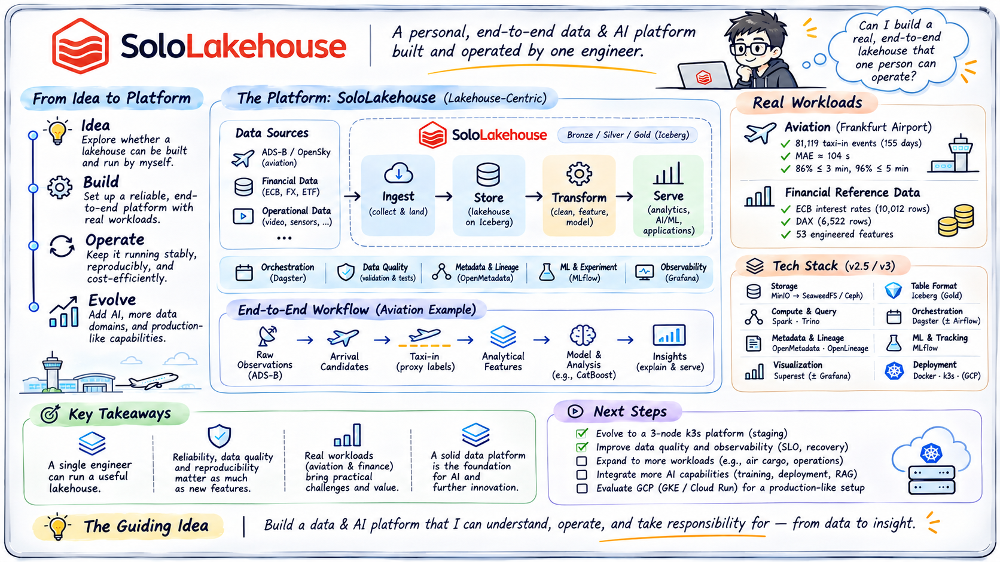
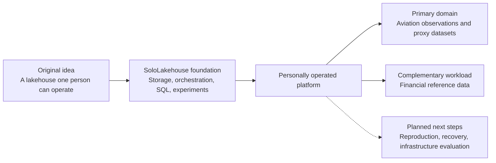

<!-- [房玄龄·2026-11-04] Owner-approved platform positioning; documentation only. -->

<p align="center"></p>

<h1 align="center">SoloLakehouse</h1>

<p align="center"><strong>A personally operated data &amp; AI platform, built on a lakehouse foundation</strong></p>

[Platform story](docs/platform-overview.md) · [Aviation workload](docs/workloads/aviation.md) · [Architecture](docs/architecture.md) · [Quick start](docs/quickstart.md) · [Roadmap](docs/roadmap.md) · [CI](https://github.com/Jiahong-Que-9527/SoloLakehouse/actions/workflows/test.yml)

<!-- [房玄龄·2026-11-06] Owner-supplied platform illustration. -->


*The illustration combines historical work and planned infrastructure. Aviation uses [observation-derived taxi-in proxies](docs/workloads/aviation.md), and the current finance reference uses EWG. See the [roadmap](docs/roadmap.md) for current status.*

**SoloLakehouse started with a simple question: could one person understand and operate a lakehouse?**

The first goal was to follow data all the way from ingestion and storage to SQL analytics and model experiments. Bringing real workloads into the system added an ongoing responsibility: understand the sources, make processing repeatable, investigate failures, and explain what the outputs can support.

That work has grown into a data platform I operate myself. **Aviation is the main domain in the operated environment, alongside financial reference data.** The platform is designed for limited resources and clear ownership, with traceable data, reproducible workflows, and recovery that can be checked.

## One platform, clear implementation boundaries

| Part | Role and current boundary |
|---|---|
| **SoloLakehouse: this public repository** | Reusable lakehouse foundation and the executable finance reference implementation. The reference runtime uses Docker Compose, Dagster, Iceberg on MinIO, Trino, MLflow, OpenMetadata, and Superset. |
| **Operated platform instance** | A self-hosted environment reusing the platform services for separate aviation and finance workloads. Runtime configuration and dated operating evidence differ from the reference clone. |
| **Aviation: primary domain** | Historical OpenSky observations around Frankfurt Airport, candidate arrival events, taxi-in proxy labels, features, baseline experiments, and analytical views. The pipeline code is maintained separately; its [workload guide](docs/workloads/aviation.md) explains the integration and evidence limits. |
| **Finance: complementary workload** | ECB policy rates and FX, plus EWG, a German-equity ETF proxy from Alpha Vantage. This repository contains its collectors, transformations, contracts, and reference demo. |

Cloning this repository gives you the finance reference flow. It does not install the separately maintained aviation pipeline. The aviation data is historical and proxy-labelled; airport-validated prediction performance and a live air-cargo transaction pipeline remain unverified.

## From an idea to an operated platform



The working goals are practical:

- **Understand the data:** record source, version, quality, missingness, and intended use.
- **Repeat the workflow:** connect a run to its tables, snapshots, features, and experiment artifacts.
- **Operate with clear ownership:** detect failures, explain dependencies, and verify recovery within a stated scope.
- **Reuse the foundation:** apply the same engineering methods to different domain workloads.

The AI scope currently includes feature preparation, baseline model experiments, evaluation, and model-artifact tracking. Broader domain AI services are a future direction. RecordChat is a separate knowledge application, with no claim of an already integrated data-to-chat system.

## Inspect the implementation and the evidence

| Question | Start here |
|---|---|
| Why did the project evolve this way? | [Platform story and operating principles](docs/platform-overview.md) |
| What does the aviation workflow produce, and what can it support? | [Aviation workload, dated snapshot, and limitations](docs/workloads/aviation.md) |
| How do the reference stack and operated environment differ? | [Architecture and deployment boundaries](docs/architecture.md) |
| How are quality and provenance represented in the reference code? | [Dataset contracts](governance/datasets/), [evidence layout](docs/governance-evidence-layout.md), and [ML lineage](docs/decisions/ADR-018-ml-lineage-five-tuple.md) |
| How are operational changes and recovery described? | [Operator runbook](RUNBOOK.md), [operational evidence](docs/operational-slo.md), and [promotion/rollback decision](docs/decisions/ADR-022-v29-promotion-operational-evidence.md) |

Published code, operator-reported observations, and future plans are labelled separately. These personal engineering workloads do not establish customer adoption, regulatory certification, an externally guaranteed SLA, or high availability.

## Run the finance reference flow

Use Linux, macOS, or Windows **WSL2** with Docker Compose, Python 3.13+, Git, and `make`. Allow at least 8 GB free RAM for the full reference stack (12 GB recommended).

```bash
git clone https://github.com/Jiahong-Que-9527/SoloLakehouse.git
cd SoloLakehouse
make setup
make verify
make demo
```

`make setup` creates local environment files from templates, installs dependencies, and starts the reference Compose services. The live EWG source needs an Alpha Vantage key in the gitignored `.env.secrets`; CI uses committed fixtures. See [Quick start](docs/quickstart.md), [Demo](DEMO.md), and [Runbook](RUNBOOK.md).

**Verification status checked 2026-11-04:** in the [latest pre-update main CI run](https://github.com/Jiahong-Que-9527/SoloLakehouse/actions/runs/36453729682), lint, typecheck, and tests passed. The Compose demo failed before startup while pulling `minio/mc`. A clean reference deployment needs to be revalidated after that image-source problem is resolved. A working operated instance does not establish that a fresh clone currently passes the demo.

## Where the platform goes next

The near-term focus is a reviewable aviation case: clear dataset definitions, source and processing evidence, quality limitations, and a reproducible explanation of success, failure, and recovery. Finance remains the reference workload for comparing calendars, missingness, freshness, and currency conversion.

A small three-node Proxmox cluster is being planned as a possible next infrastructure stage. Workload placement, storage, backups, and recovery still need design and validation. This is not a delivered cluster or a completed Kubernetes migration.

The repository keeps its v2.5 Compose runtime baseline, with evidence work on `main` through v2.9 and the latest published tag at v2.6.1. See the [roadmap](docs/roadmap.md) for scope and [TASKS.md](TASKS.md) for execution order. New services, runtime migrations, and domain integrations need their own bounded implementation work.

## License

[MIT](LICENSE)
