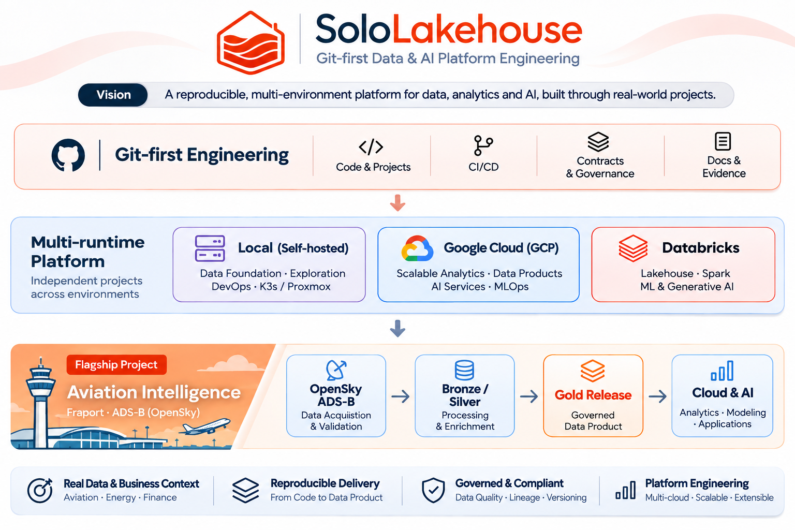

# SoloLakehouse

SoloLakehouse is a personal portfolio of independent **Data and AI platform engineering** projects. It covers the full path a data product travels: reliable ingestion from imperfect sources, validated and versioned datasets, delivery on managed cloud services, and the DevOps practice that ships, observes and recovers all of it. Each project owns its inputs, environment and acceptance checks, and records the evidence behind every claim.



## Projects

| Project | Question it answers | What is built | Evidence / status |
|---|---|---|---|
| [**Frankfurt Airport ADS-B Intelligence**](Frankfurt-Airport-adsb-intelligence/README.md) | Can **incomplete aircraft observations** around Frankfurt Airport support **reproducible analysis**? | Local OpenSky collector with **checksummed manifests** and **resumable runs**; **DuckDB** Silver and Gold layers; versioned releases through a **Release Gate** that blocks failing data | **90%** · **46 of 60** acquisition batches backed up. Two-year data, offline model and Dagster recovery verified. Cloud Run awaits measured receipt times. |
| [**Data Engineering**](Data-engineering/README.md) | Can a **hybrid EV-charging and roaming** workload be delivered as a governed warehouse on **dbt, DuckDB, BigQuery and Airflow**? | Resumable raw ingestion, **Kimball** marts, dbt tests and contracts, incremental **SCD Type 2**, Slim CI, BigQuery FinOps, local **Airflow** | **62%** · **E01–E05 implemented & merged** (PRs #277/#290/#295/#309 + this stage): locked German open-data fixtures with a deterministic generator, a 15-model dbt star schema with zero-fan-out proof, enforced contracts on all five marts, golden-example `unit_tests`, `fct_daily_revenue` v1→v2 versioning, **SCD Type 2** with simulated snapshot time, an incremental **48h-lookback merge** proven against `--full-refresh`, reusable cross-db macros, BI/ML **exposures**, 100% documented mart columns, and **Slim CI** (`state:modified+` selection proven for downstream and upstream edits). Contract at **v1.5**. E06–E08 planned. |
| [**ML Engineering**](Mlops-engineering/README.md) | Can one ML system be **closed end to end**, from features to **drift-triggered retraining**? | **Point-in-time features**, rolling backtests, **MLflow** lineage, release gate, batch and online serving, drift monitoring, **Dagster** | **100%** · **M01–M09 accepted**. Model rollback and Dagster retraining verified. The template onboarded a second workload. |
| [**DevOps Engineering**](Devops-engineering/README.md) | How does a service travel from a **source change** to a **verified deployment**, and recover from a bad release? | **Seven stages:** reproducible dev, containers, **CI** with supply-chain checks, **digest rollback**, **Kubernetes GitOps** drills, incident recovery, reusable template | **100%** · **D01–D07 accepted**. Delivery and rollback drills passed. The template onboarded a second service. |
| [**Google Cloud**](gcp/README.md) | How are **data products** delivered and governed on managed cloud services? | Scheduled **Cloud Run** batch job to **Cloud Storage and BigQuery**; authenticated **API** over an authorized view; **Pub/Sub** event processing with dedup and replay; governed release with contracts | **100%** · **G01–G06 delivered**. G06 Alpha deployed and smoke-tested. All six projects delivered: the Cloud Platform Factory applied two isolated stacks through Workload Identity Federation, proved the cross-stack read denial (403) with a same-stack control, and destroyed both stacks with zero residual resources. |
| [**Databricks**](databricks/README.md) | How does a **governed lakehouse** product run on Databricks? | **Delta** tables, scheduled jobs, **CDC** with corrections, **Unity Catalog**, MLflow forecasting, workspace provisioning | **11%** · **D01 implemented locally**. Free Edition verification pending. D02–D05 planned and D06 deferred. |

## Delivery progress


Progress estimates combine accepted stages and documented partial work across each project's roadmap.

The earlier self-hosted lakehouse (Compose, Dagster, Iceberg, Trino) is preserved in a [pinned snapshot](https://github.com/Jiahong-Que-9527/SoloLakehouse/tree/741e6da82cdc2cad207aa6ee707b8fb157b0174a); a fixture reproduction is a later milestone.

## Capabilities and target roles

| Project | What it shows | Target roles |
|---|---|---|
| Frankfurt Airport ADS-B Intelligence | **Resumable bulk ingestion**, **manifest commits**, data quality semantics, **DuckDB** Silver and Gold modelling, **data contracts** and **release gates** | **Data Engineer** · **Data Platform Engineer** |
| DevOps Engineering | **Docker**, **GitHub Actions**, image **supply-chain checks**, **digest-based rollback**, **k3d and Helm GitOps**, **observability**, incident drills, service templates | **DevOps Engineer** · **Platform Engineer** · **SRE** |
| Google Cloud | **Cloud Run**, **BigQuery**, **Pub/Sub**, **Terraform**, **Workload Identity Federation**, authorized views, **idempotent event processing**, governed data products | **Cloud Data Engineer** · **Backend Engineer (data)** |
| Data Engineering *(in progress)* | **dbt**, **DuckDB**, **BigQuery**, **Airflow**, data contracts, incremental SCD | **Data Engineer** |
| ML Engineering *(in progress)* | **Point-in-time features**, evaluation, **model registry**, **drift monitoring**, orchestration | **MLOps Engineer** · **ML Engineer** |
| Databricks *(in progress)* | **Delta**, **Jobs**, **CDC**, **Unity Catalog**, workspace provisioning | **Lakehouse Engineer** |

A capability counts as demonstrated only where the repository holds code, tests and recorded evidence.

## Run the checks

With Python 3.12+ and [uv](https://docs.astral.sh/uv/). Tests use synthetic data and need no cloud account or live source.

```bash
cd Frankfurt-Airport-adsb-intelligence/01-opensky-acquisition   # or gcp/01-european-energy-pipeline
uv sync --locked && uv run --locked pytest
```

Raw datasets, credentials and runtime state stay outside Git; the repository holds code, contracts, designs and evidence summaries.

[Engineering roadmap](docs/roadmap.md) · [Aviation plan](Frankfurt-Airport-adsb-intelligence/docs/project-plan.md) · [Project template](project-template/README.md)

## License

Code and documentation are licensed under the [Apache License 2.0](LICENSE). Public data slices used as fixtures (Bundesnetzagentur, SMARD, ECB) stay under their providers' terms, and OpenSky-derived summaries remain subject to the OpenSky Network terms; see [NOTICE](NOTICE). SoloLakehouse is an independent project, not affiliated with Frankfurt Airport's operator or DFS.
