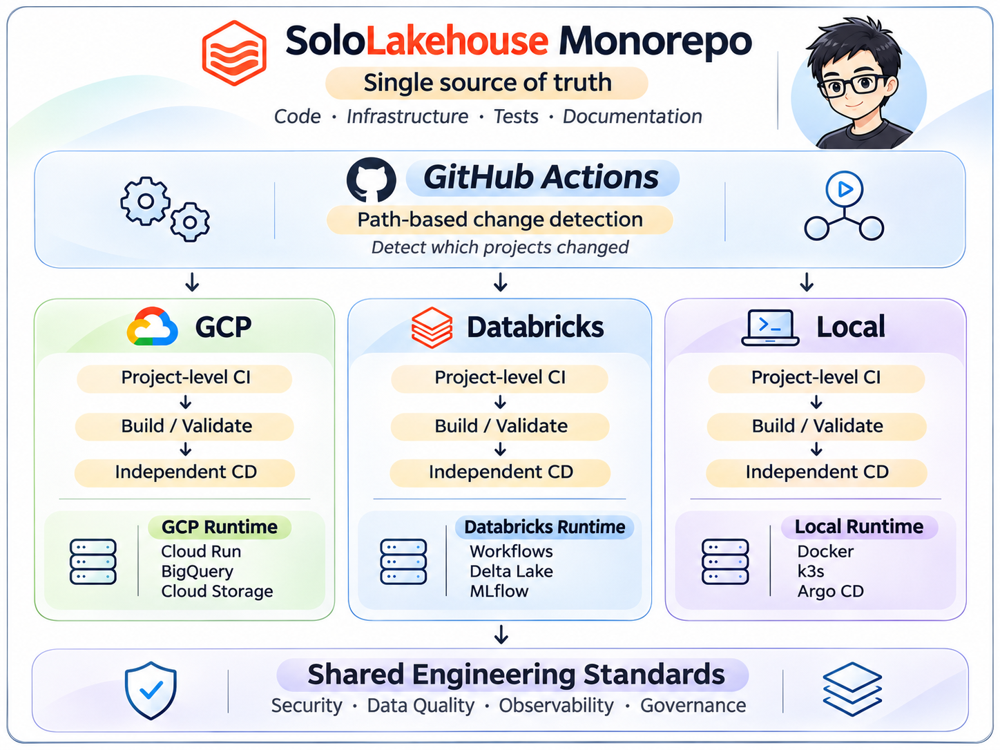
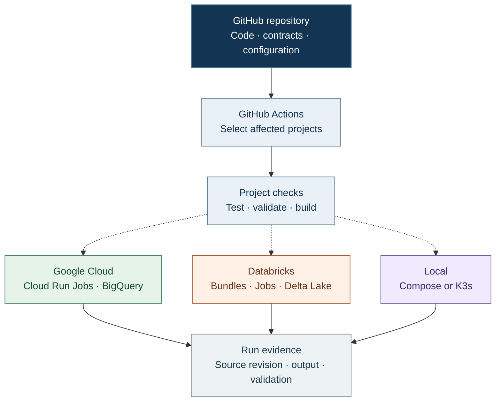

# SoloLakehouse

<!-- [Codex · 2026-11-13] Initial platform and project layout. -->
<!-- [Codex · 2026-11-13] Named projects and milestones. -->
<!-- [Codex · 2026-11-13] Project positioning and domain navigation. -->
<!-- [房玄龄·2026-11-15] Document the OpenSky pilot, batch development and current project layout. -->

SoloLakehouse is a Git-first repository for reproducible data and AI projects.
The first implementation under the current layout acquires historical aircraft
observations around Frankfurt Airport (FRA / EDDF). The repository also
contains project briefs for Google Cloud, Databricks and local infrastructure.

## Fraport ADS-B Intelligence

[Fraport ADS-B Intelligence](Fraport-adsb-intelligence/README.md) starts with
[OpenSky Acquisition](Fraport-adsb-intelligence/01-opensky-acquisition/README.md).
The Python CLI collects hourly ADS-B state vectors and daily flight records
from OpenSky Trino, writes Parquet with checksummed manifests, and resumes
from the last committed hour.

- **Pilot verified.** All 168 hours of the pilot week matched the source during
  reconciliation. An interrupted hour was recovered with the same SHA-256
  checksum, and a repeat run left the manifests unchanged.
  [Acquisition status](Fraport-adsb-intelligence/01-opensky-acquisition/README.md#status-2026-11-14)
  · [Benchmark report](Fraport-adsb-intelligence/01-opensky-acquisition/docs/benchmark-report.md)
- **Monthly batch workflow in development.** The local implementation adds
  `validate`, `report`, `accept` and `publish` for batch checks, reporting,
  acceptance records and a checksum-verified backup. The next milestone is to
  collect, validate, accept and back up the October 2026 batch (`b01`).
  [Batch plan](Fraport-adsb-intelligence/01-opensky-acquisition/docs/batch-plan.md)
- **Downstream work planned.** Build Silver and Gold locally, then release an
  approved, versioned Gold dataset for cloud analytics and lakehouse
  integration. Later stages cover taxi-in modeling, serving and orchestration.
  [Aviation project plan](Fraport-adsb-intelligence/docs/project-plan.md)

Raw research data stays private. Public examples use synthetic or approved
data. ADS-B-derived taxi-in labels are proxies. Airport ground truth requires
independent validation.

## Planned projects

### Aviation integrations

- [Aviation Lakehouse Integration](Fraport-adsb-intelligence/04-aviation-lakehouse/README.md)
  (Databricks). Read Gold releases into Spark and Delta Lake, then check
  event identity, proxy-label coverage and the feature cutoff.
- [Model Serving Integration](Fraport-adsb-intelligence/06-model-serving/README.md)
  (Google Cloud). Serve a pinned taxi-in model version from Cloud Run and
  trace each response to that version.

### European energy

- [European Energy Pipeline](gcp/01-european-energy-pipeline/README.md) (Google
  Cloud). Validate one German electricity-market metric over a fixed date
  range before connecting the pipeline to cloud storage and analytics.
  [Design](gcp/01-european-energy-pipeline/docs/design.md)
- [Energy Analytics API](gcp/02-energy-analytics-api/README.md) (Google Cloud). Expose an
  approved load indicator through a read-only Cloud Run API.
  [Design](gcp/02-energy-analytics-api/docs/design.md)
- [Aviation Event Processing](gcp/03-aviation-event-processing/README.md) (Google Cloud).
  Test corrections, retries and dead-letter recovery against an isolated
  BigQuery target.
  [Design](gcp/03-aviation-event-processing/docs/design.md)

### Finance

- [ECB Silver Pipeline](local/ecb-silver-pipeline/README.md) (Local). Convert
  a fixed set of ECB policy-rate inputs into clean, comparable Silver rows.
- [ECB Delta Lakehouse](databricks/01-ecb-delta-lakehouse/README.md)
  (Databricks). Build a versioned Gold product from one ECB daily
  exchange-rate series.
  [Design](databricks/01-ecb-delta-lakehouse/docs/design.md)

### Platform engineering

- [Self-hosted Lakehouse](local/self-hosted-lakehouse/README.md) (Local).
  Reproduce a small data flow using Compose, Dagster, Iceberg and Trino.
  [Legacy reference snapshot](https://github.com/Jiahong-Que-9527/SoloLakehouse/tree/741e6da82cdc2cad207aa6ee707b8fb157b0174a)

<!-- [Codex · 2026-11-13] Monorepo overview and target delivery flow. -->

## Architecture

The illustration shows the target platform. GitOps tooling will be selected
at the K3s milestone.

### Project delivery flow

Dashed links mark planned release paths. Each project can validate and release
independently. Runtime evidence links the deployed revision to its result.

## Engineering and delivery

GitHub versions engineering definitions, including code, tests, deployment
configuration and architecture decisions. Data, credentials and runtime
state belong in their respective systems. Each project owns its inputs,
tests and delivery lifecycle.

- [Engineering roadmap](docs/roadmap.md) covers the platform milestones.
  The [aviation project plan](Fraport-adsb-intelligence/docs/project-plan.md)
  tracks the current OpenSky delivery sequence.
- [Project template](project-template/README.md) provides a starting
  structure for a new project.
- Browse projects by runtime in [Google Cloud](gcp/), [Databricks](databricks/)
  and [Local](local/).
