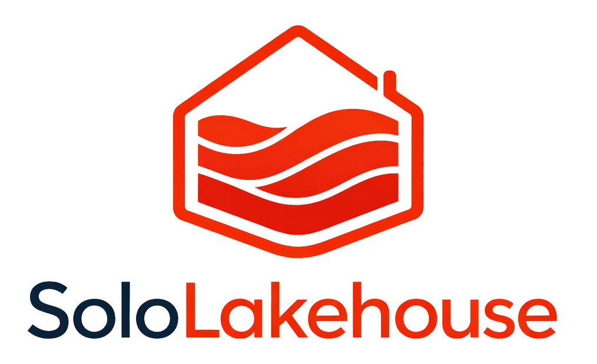

<!-- [房玄龄·2026-11-10] Owner-approved single-repository v3 design and construction plan; hardware not provisioned. -->

<p align="center"></p>

<h1 align="center">SoloLakehouse</h1>

<p align="center"><strong>A personally operated data and AI platform, built on a lakehouse foundation</strong></p>

<p align="center">
  <a href="docs/design/v3/README.md">V3 construction plan</a> &middot;
  <a href="docs/architecture.md">Reference architecture</a> &middot;
  <a href="docs/quickstart.md">Compose reference</a> &middot;
  <a href="docs/workloads/aviation.md">Aviation case</a> &middot;
  <a href="docs/README.md">Documentation</a> &middot;
  <a href="TASKS.md">Next work</a>
</p>

**Current stage — v3 design and repository preparation.** Three Mini PCs have
not been provisioned. The Proxmox/K3s cluster, GitOps deployment, and new
infrastructure directories describe a construction plan. They are not a
deployed platform or a completed migration.

SoloLakehouse started with a practical question: can one person understand a
data platform from ingestion through storage, SQL, model experiments, and
recovery? The repository contains the finance reference implementation and
the contracts, lineage, quality checks, and experiment evidence built around it.
The next step is to make that foundation reproducible and operable through
infrastructure as code and GitOps.

## What is here today

| Area | Implemented reference / boundary |
|---|---|
| Data flow | ECB policy rates and FX, plus Alpha Vantage EWG, a German-equity ETF proxy; Bronze/Silver/Gold Iceberg transformations. |
| Runtime path | Docker Compose, Dagster, PostgreSQL, Hive Metastore, MinIO, Trino, MLflow, OpenMetadata, and Superset. Existing paths are retained. |
| Governance | Dataset contracts, quality checks, source/run/snapshot lineage, ML evidence, and operational evidence adapters. Evidence limitations remain explicit. |
| Aviation | The primary operated use case is maintained separately. This public clone contains its [integration guide](docs/workloads/aviation.md), not the private pipeline or datasets. |
| V3 | A documented single-repository target for Proxmox, K3s, Flux, deployment packaging, recovery, and phased validation. No hardware deployment has been performed. |

Aviation uses historical observations and observation-derived taxi-in proxies.
These are not airport-validated labels or a demonstrated air-cargo transaction
loop. Finance remains the public, reproducible engineering reference. Training,
evaluation, and MLflow tracking are in scope; online serving and an operations
agent are later candidates.

## V3: three hosts, one repository, clear ownership

The planned starting hardware is three GMKtec M6 Ultra systems, each with 32GB
RAM and a 1TB SSD. Each PVE host initially carries one 24GiB K3s server VM that
also runs application workloads. An existing NAS is the proposed independent
backup destination. Resource budgets are estimates awaiting measurement.

| Repository area | Responsibility | Current maturity |
|---|---|---|
| [infra/](infra/README.md) | PVE resources, VM lifecycle, state and recovery design | Design only |
| [bootstrap/](bootstrap/README.md) | First boot, K3s installation, upgrades and rebuilds | Design only |
| [deploy/](deploy/README.md) | Reusable SLH deployment packaging and application contracts | Design only |
| [gitops/](gitops/README.md) | Flux entry point, platform components and environment configuration | Design only |
| Existing Python modules | Ingestion, transformation, governance, orchestration and ML | Existing code; preserved |
| [docs/design/v3/](docs/design/v3/README.md) | Construction sequence, decisions, migration and acceptance | Design; checks recorded separately |

The control boundaries are deliberate:

- **OpenTofu + cloud-init/Ansible** establish VMs and K3s from an external
  administration environment.
- **CI** tests code and produces immutable images and, later, versioned charts.
- **Flux** reconciles reviewed deployment configuration.
- **Dagster** schedules and executes data and ML work.

Cluster bootstrap, IaC state, decryption keys, and recovery instructions must
remain usable when the target cluster is unavailable. Git can reconstruct
configuration; recovering databases, catalogs, objects, and model artifacts
requires separate, tested procedures.

Start with the [complete construction plan](docs/design/v3/README.md),
[target architecture](docs/design/v3/architecture.md), and
[storage/recovery design](docs/design/v3/storage-and-recovery.md).
The [roadmap](docs/roadmap.md) owns scope; [TASKS.md](TASKS.md) owns execution order.

## Inspect and validate the repository

These commands inspect the repository without starting the runtime:

```bash
make help
make docs-check
make check-agent-docs
```

With the documented Python dependencies installed, the existing checks remain:

```bash
make lint
make typecheck
make validate-contracts
make test
```

These results establish only what each check exercises. A passing Markdown
check does not validate a Helm chart, a VM, a data restore, or cluster HA.

## Use the existing finance reference

The [quick start](docs/quickstart.md), [demo](DEMO.md), and
[runbook](RUNBOOK.md) describe the existing Compose reference path.
It remains the development and regression reference while v3 is constructed.

The previously observed clean-clone MinIO client image-pull problem has not
been resolved or revalidated by this design change. Object-storage supply and
compatibility are explicit [pre-migration work](docs/design/v3/storage-and-recovery.md#object-storage-decision).
Do not infer a successful fresh deployment from retained configuration or
from a separately operated environment.

Routine shutdown uses `make down` and preserves bind-mounted data.
The legacy `clean`, `reset-mlflow-db`, and `purge-legacy-docker-volumes`
targets are disabled: data destruction requires an exact, reviewed recovery
or disposal procedure, not a general cleanup command.

## What completion will mean

V3 acceptance requires more than running Pods:

1. Rebuild the declared environment with its documented bootstrap inputs.
2. Trace a reviewed code change through image digest, GitOps commit, and run.
3. Execute and validate the reference Iceberg/Gold workflow.
4. Recover a consistent catalog and object-data state in isolation.
5. Regress existing governance, MLflow, metadata, and BI capabilities.
6. Record measured resource use, failure behavior, and recovery times.

The [migration and validation plan](docs/design/v3/migration-and-validation.md)
defines the evidence and boundaries for each stage. No delivery date, hardware
availability, production SLA, or whole-platform HA is claimed.

## History and license

The [pre-v3 checkpoint](https://github.com/Jiahong-Que-9527/SoloLakehouse/releases/tag/pre-v3-2026-11-10)
preserves the earlier main baseline. Superseded planning and the original
versions of rewritten entry documents are retained in the
[pre-v3 archive](docs/history/pre-v3/README.md), with source hashes and commit
provenance.

[Project history](docs/history/README.md) · [Platform story](docs/platform-overview.md) · [MIT license](LICENSE)
