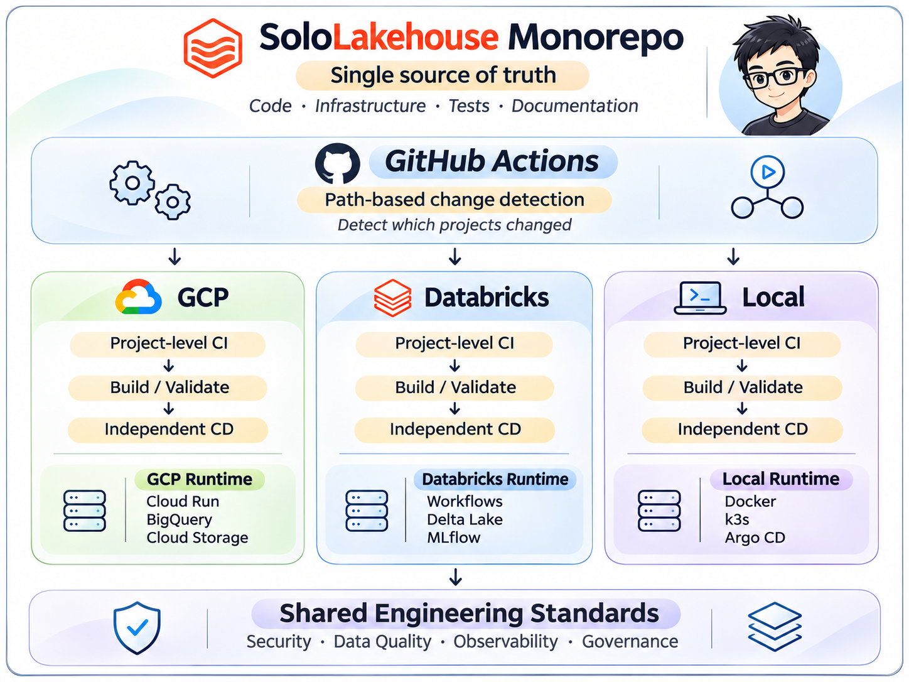
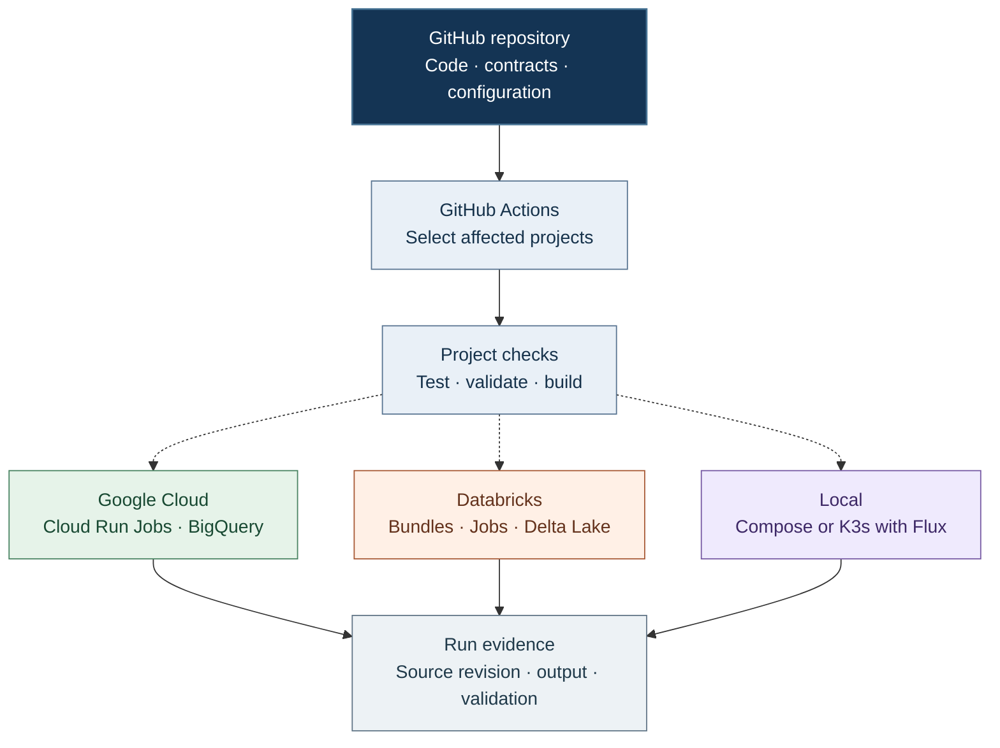

# SoloLakehouse

<!-- [Codex · 2026-11-13] Initial platform and project layout. -->
<!-- [Codex · 2026-11-13] Named projects and milestones. -->
<!-- [Codex · 2026-11-13] Project positioning and domain navigation. -->

SoloLakehouse is a Git-first Data & AI engineering initiative. It brings
independent projects together across Google Cloud, Databricks and self-hosted
infrastructure, with an emphasis on reproducible data and ML workflows.

The current `main` contains project briefs, a reusable project template and
the engineering roadmap. The six projects below are planned. The earlier
self-hosted lakehouse is retained as a versioned reference.
[Legacy reference snapshot](https://github.com/Jiahong-Que-9527/SoloLakehouse/tree/741e6da82cdc2cad207aa6ee707b8fb157b0174a)

<!-- [Codex · 2026-11-13] Monorepo overview and target delivery flow. -->

## Architecture

The illustration shows the target architecture. Its Local lane depicts Argo CD.
The current [roadmap](docs/roadmap.md) uses Flux for the planned K3s milestones.

### Project delivery flow

Dashed links mark planned release paths. Each project can validate and release
independently. Runtime evidence links the deployed revision to its result.

## Projects

### Aviation

- [Aviation Lakehouse](databricks/aviation-lakehouse/README.md) (Databricks).
  Trace aircraft observations through candidate arrivals, proxy labels and
  features. The first milestone checks reproducibility, label coverage and
  feature cutoff on synthetic or approved data.
- [Aviation ML Serving](gcp/aviation-ml-serving/README.md) (Google Cloud).
  Define a prediction interface and trace each response to a model version.
  Start with a synthetic request and response contract.

### European energy

- [European Energy Pipeline](gcp/european-energy-pipeline/README.md) (Google
  Cloud). Validate one German electricity-market metric over a fixed date
  range before connecting the pipeline to cloud storage and analytics.

### Finance

- [ECB Silver Pipeline](local/ecb-silver-pipeline/README.md) (Local). Convert
  a fixed set of ECB policy-rate inputs into clean, comparable Silver rows.
- [Financial ML Pipeline](databricks/financial-ml-pipeline/README.md)
  (Databricks). Build a time-ordered baseline using versioned financial series.

### Platform engineering

- [Self-hosted Lakehouse](local/self-hosted-lakehouse/README.md) (Local).
  Reproduce a small data flow using Compose, Dagster, Iceberg and Trino.

## Engineering and delivery

GitHub versions engineering definitions, including code, tests, deployment
configuration and architecture decisions. Data, credentials and runtime
state belong in their respective systems. Each project owns its inputs,
tests and delivery lifecycle.

- [Engineering roadmap](docs/roadmap.md) covers scope, delivery order and
  evidence for each milestone.
- [Project template](project-template/README.md) provides a starting
  structure for a new project.
- [Google Cloud](gcp/) · [Databricks](databricks/) · [Local](local/) browse
  the repository by runtime. Each platform has a reserved third slot.
