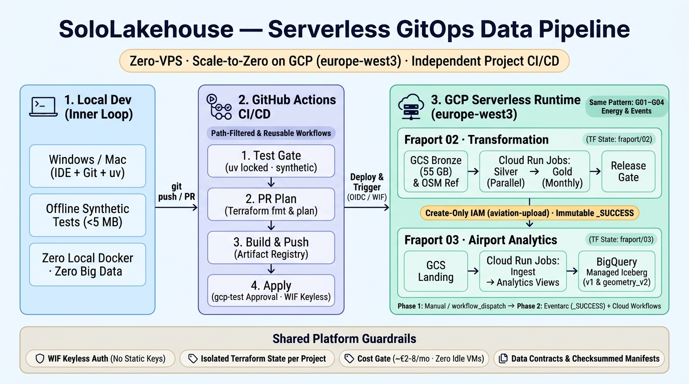
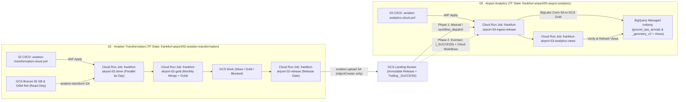

# SoloLakehouse — Serverless GitOps Data Pipeline 云端架构与实施蓝图

> **[Antigravity·2026-11-22]** 本文档整理自 `SoloLakehouse` 云端化与项目独立 CI/CD 架构专题讨论，基于仓库基线 `main` / `a83c4b6`（PR #256）现状实测撰写。
> **当前状态：** 架构规划与实施蓝图基线，**尚未执行**任何代码修改、数据上传或云资源变更。

---

## 0. 文档定位

本文档旨在为 `SoloLakehouse` 的后续云端化改造与求职作品集收口提供统一参考，涵盖四部分内容：

1. **总思路**：为什么选择 **Serverless GitOps Data Pipeline**（而非自建 VPS 或开关机 GCE VM）作为开发与运行模式；
2. **全仓应用模型**：如何让 Monorepo 下的多个项目、子项目与子步骤各自独立 CI/CD 到最合适的 GCP 组件；
3. **仓库成熟度体检与平台收敛路线**：基于 `a83c4b6` 的实测清单与最小改造 PR 路线；
4. **`Frankfurt-Airport-adsb-intelligence` `02` & `03` 云端接入详细设计**：落地 2026-11-22 已拍板的四项核心裁定，明确架构边界、代码改造面、Terraform/Workflow 接线、成本护栏与后续演进路径。

---

## 架构总览图（Executive Overview）



> **一图读懂**：本地仅做轻量开发与离线合成测试（Inner Loop）；推送 GitHub 后经由无密钥 WIF CI/CD 自动校验、构建并按需部署（Outer Loop）；云端所有项目按独立 Terraform State 与最小权限运行在 `europe-west3` Serverless 组件上，空闲归零、零常驻 VM。

---

## 一、总思路：为什么选择 Serverless GitOps Data Pipeline

### 1.1 核心诉求

- **摆脱基础设施运维负担**：不依赖自建 VPS（`fin`/`dev`/`avi`/`llm`），也不把本机 Windows WSL 变成背负数十 GB 数据与重型 Docker Desktop 容器的唯一宿主机；
- **多终端无缝开发**：Windows PC 与 Mac Pro 只作为轻量代码编辑与测试终端，通过 `git push` 即可在云端完成构建、部署与数据处理；
- **作品集叙事统一且边界清晰**：对外以单一 Monorepo 展示平台全局工程能力，同时保证内部每个项目都能「**单独拉出来走独立 CI/CD，部署到最匹配的 GCP 组件上直接处理云端数据**」。

### 1.2 开发与运行架构选型对比

| 方案 | 开发与构建方式 | 数据存储与处理 | 成本与运维特征 | 结论 |
|---|---|---|---|---|
| **方案 A：常驻开关机 GCE VM** | 本机或 Remote-SSH 连云端 VM 手工开发/跑批 | 数据在 GCS/BQ 或挂盘 | 停机期间持久盘（100 GB `pd-balanced` 约 \$12/月）与未绑定静态 IP（约 \$7/月）照常扣费；忘关机极易击穿预算；每次开发需等起停机 | ❌ 不推荐 |
| **方案 B：本地 WSL / 个人 VPS** | WSL 或 `fin` Remote-SSH + 本地 Docker | 本地落盘为主 | 强绑定私人机器；Mac/Windows 切换或重装环境成本高；脱离纯云端可复现作品集定位 | ❌ 非纯云目标 |
| **方案 C：Serverless GitOps Data Pipeline（选定）** | **Inner Loop**：本地轻量 IDE + `uv` + `<5 MB` 合成样例毫秒级 `pytest`<br>**Outer Loop**：`git push` → GitHub Actions（WIF 无密钥）构建镜像与 `terraform apply` | 数据常驻 `europe-west3` 私有 **GCS + BigQuery**；计算通过 **Cloud Run Jobs / Services / BigQuery** 按需拉起，跑完归零 | 无常驻算力、无忘关机账单焦虑、零静态密钥、与既有 `G01–G04` 工程体系完全同构 | ✅ **最终选定** |

### 1.3 必须遵守的四条工程纪律

1. **计算下推与同区闭环（零跨区 Egress）**：所有 GCS 桶、Artifact Registry、BigQuery 数据集与 Cloud Run 计算全部锁定 **`europe-west3`（法兰克福）**。重扫描与聚合直接在云端内网执行，绝不把大数据集拉回本地处理。
2. **禁止把 CI 当日常调试工具（Inner / Outer Loop 分离）**：本地始终保留 `<5 MB` 合成样例与单元测试，在 Windows/Mac 上秒级验证逻辑；单测绿灯后再 `git push` 触发 GitHub Actions 上云跑真实数据。
3. **无状态计算 + 原子标记**：Cloud Run 容器不保存本地状态，所有参数通过环境变量注入；批处理产出严格将 `run_manifest.json` 或 `_SUCCESS` 作为最后一个上传对象，保证可安全重跑与幂等跳过。
4. **严格遵守 `AGENTS.md` GCP 成本闸门**：使用 Free Trial 账单 `01FCE3-C90698-BFE584`（€269 额度，2027-02-11 到期）。禁用 Cloud Composer、常驻 VM、闲置外部静态 IP、Cloud NAT、负载均衡器等按小时计费的常驻高危 SKU；大批量上传、全量 backfill 与超自由额度操作前必须按规定逐次报价并获主人批准。

---

## 二、Serverless GitOps 在 `SoloLakehouse` Monorepo 中的全仓应用模型

### 2.1 四层实体映射关系

为了让“多项目 + 多子项目 + 多子步骤”既统一管理又互不耦合，全仓按四层拆分职责：

| 层级 | 仓库载体 | GCP 对应实体 | 设计原则 |
|---|---|---|---|
| **1. 全仓公共底座** | 公共引导底座（拟从 G01 剥离至独立底座/`gcp/06`） | GCP Project、GitHub OIDC/WIF Pool、Terraform State Bucket、共享预算基线 | 建一次、全仓复用；不绑定任何业务表或业务桶 |
| **2. 独立项目边界** | 如 `gcp/01-*`、`Frankfurt-Airport-adsb-intelligence/02-*`、`03-*` | 专属 Service Account、专属 GCS 桶/前缀、BigQuery Dataset、独立 Terraform State Prefix | 权限、数据、账单和 `terraform destroy` 影响面严格隔离 |
| **3. 子步骤运行单元** | 子项目内各处理阶段（如 `silver` / `gold` / `release` / `ingest` / `views`） | 独立的 **Cloud Run Job**（批处理）或 **Cloud Run Service**（HTTP API） | 每一步可独立设 CPU/RAM、独立挂载最小权限 SA、独立重跑 |
| **4. 编排与触发层** | `07-platform-orchestration` 或项目调度配置 | **Cloud Scheduler**（定时） / **Eventarc**（事件） / **Cloud Workflows**（多步编排） | 在子步骤稳固后再引入，不用重型编排器绑死单体步骤 |

### 2.2 容器镜像粒度取舍

> **核心原则：按「依赖栈」切分镜像，按「执行边界与最小权限」切分 Cloud Run Job。**

- **同构依赖共用镜像**：例如 `02-aviation-transformation` 下的 `silver_v2`、`merge_silver_month`、`gold_ground_ops`、`release_gate` 均使用同一套 Python 3.13 + DuckDB/PyArrow 环境，只需打 **1 个镜像**，通过不同 Cloud Run Job 的 `--args`（入口命令）和不同内存/SA 配置区分。
- **异构重依赖拆独立镜像**：例如模型训练/服务（`scikit-learn`/`lightgbm`）或独立 `dbt-bigquery` 运行时，拆成独立 `Dockerfile`，避免改一行采集或 SQL 触发整个重型 ML 镜像重编译。

### 2.3 GitHub Actions 两级路由模型

1. **共享可复用工作流（Reusable Workflows）消除复制粘贴**：
   - 将所有 GCP 交付共享的 `test → PR plan → build-push → apply (environment: gcp-test)` 逻辑抽入 `.github/workflows/_reusable-gcp-delivery.yml`。
   - 各项目入口文件瘦身为 **20–30 行声明式配置**（传入 `working-directory`、`python-version`、`test-command`、`image-name`、`build-image: true/false` 等）。
2. **严格路径过滤 + 手动按批触发**：
   - 每个项目入口仅通过 `on.push.paths` 与 `on.pull_request.paths` 监听自身目录与自身 workflow 文件（如改 `local/` 绝不触发 `gcp/` 或 `Frankfurt Airport`）。
   - 对于多子步骤同仓演进的场景，可进一步结合 `dorny/paths-filter` + `matrix` 做到“改哪步只测、只发哪步”。
   - 统一保留 `workflow_dispatch`，支持直接从 GitHub 网页传入 `batch` / `month` / `release_id` 手动触发云端重跑，无需依赖本机终端。

### 2.4 Terraform 两层 State 隔离

所有项目共享同一个底层 GCS State Bucket，但强制按子项目路径隔离 `prefix`：

```text
gs://<state-bucket>/
├── foundation/                             # 公共 WIF、AR、公共底座（拟从 G01 剥离）
├── gcp/01-european-energy-pipeline/        # G01 专属 State
├── gcp/02-energy-analytics-api/            # G02 专属 State
├── gcp/03-aviation-event-processing/       # G03 专属 State
├── gcp/04-governed-energy-data-product/    # G04 专属 State
├── frankfurt-airport/02-aviation-transformation/     # Frankfurt Airport 02 专属 State（新增）
└── frankfurt-airport/03-airport-analytics/           # Frankfurt Airport 03 专属 State（已有）
```

任意项目都可以单独执行 `terraform plan` / `apply` / `destroy`，绝不锁死或误删其他项目的云资源。

### 2.5 单项目「可独立拉出 CI/CD」的 5 件套准入标准

以后仓库中任何新旧项目，只要补齐以下 5 件套，即视为具备独立交付到 GCP 的成熟度：

1. **`README.md`**：业务问题、架构图、GCP 组件选型理由（PCA 取舍）、成本与验收证据；
2. **`pyproject.toml` + `uv.lock` + 离线单测**：纯合成样例即可跑通，不依赖真实私有数据或云连接；
3. **无状态运行包（`Dockerfile`）**：所有输入/输出路径、项目 ID 与批次号全部经由 CLI 参数或环境变量注入；
4. **`infra/` 目录**：独立 Terraform 配置、独立 GCS State Prefix、最小权限专属 Service Account；
5. **`.github/workflows/<project>.yml`**：路径隔离、**`test` 门禁前置**、PR 自动 `plan`、合并 `main` 后经 `gcp-test` 人工审批 `apply`，支持 `workflow_dispatch`。

---

## 三、仓库现状成熟度体检与平台收敛路线（基于 `a83c4b6` 实测）

### 3.1 仓库现状总体评价：**7.5–8 / 10**

截至 `2026-11-22`（`main` / `a83c4b6`，PR #256），仓库的底座纪律与真实云交付能力已经相当扎实：
- **`G01–G04` 与 `Frankfurt Airport phase 03` M2 已在 GCP 实测上线**，全线走 **WIF 免密钥认证**、GitHub Actions 引用锁定 **Full Commit SHA**、`apply` 挂有 **`environment: gcp-test` 人工审批门**；
- 全仓坚持 `uv sync --locked` 离线可复现测试，并将 `AGENTS.md` GCP 成本闸门写为强制规则。

### 3.2 六项待收敛短板（附代码实证）

| 优先级 | 问题 | 仓库实证 | 风险与影响 |
|---|---|---|---|
| **P0** | **云交付流水线缺少 `needs: test` 强门禁** | `energy-cloud.yml`、`energy-api.yml`、`governed-energy-product-cloud.yml`、`aviation-event-cloud.yml` 中 `build-push` 与 `test` 并行，且 `apply` 只 `needs: build-push`；`aviation-analytics-cloud.yml` 的 `apply` 亦无 `needs: test` | 直接推送 `main` 且单测失败时，坏镜像仍会被推入 Artifact Registry 并进入审批队列 |
| **P0** | **同一项目存在重复触发的 Workflow** | `energy-pipeline.yml`（33 行）与 `energy-cloud.yml` 监听完全相同的 `gcp/01-european-energy-pipeline/**`；`aviation-event-processing.yml`（33 行）与 `aviation-event-cloud.yml` 监听完全相同的 `gcp/03-aviation-event-processing/**` | 每次改动跑两遍单测，Actions 面板冗余杂乱（对比 `energy-api.yml` 已正确合并） |
| **P1** | **5 份云交付 Workflow 复制粘贴严重且含硬编码业务参数** | 5 份云交付 workflow 合计约 545 行高度重复；`governed-energy-product-cloud.yml` 的 `apply` 硬编码了 `input_release_id=0f249cdb2d1c44ab8155fb810b178302` 和 `candidate_id=cand-2026-11-21-third` | 后续接 `Frankfurt Airport 02/03`、`G05` 时维护成本倍增；无关 infra 改动会触发重复发布旧 `candidate_id` |
| **P1** | **公共云底座「寄宿」在 `G01` 内** | `gcp/04-governed-energy-data-product/infra/versions.tf` 与 `Frankfurt-Airport-adsb-intelligence/03-airport-analytics/infra/versions.tf` 均注明 Terraform state bucket（`slh-gcp-test-tfstate`）与 WIF pool 继承自 `G01` 的 `BOOTSTRAP.md` | 与“所有项目平级独立”矛盾，也与计划中的 `gcp/06-cloud-platform-factory` 职责重叠 |
| **P1** | **根 `README.md` 滞后，低报已完成成果** | `README.md` 仍将 `ML Engineering` 写成 `M01–M04 accepted` 并在能力表里标注 `ML Engineering (planned)`；但 `git log` 显示 **M05（PR #249）与 M06（PR #252）均已合并** | 面试官仅看首页会漏掉完整的训练注册与在线/批量推理成果 |
| **P2** | **模板、历史目录、单测规范与未跟踪目录有待对齐** | ① `project-template/` 停留在 2026-11-13（仍用 `requirements.txt` + `infra/terraform/`，与实战 `uv.lock` + `infra/` 脱节）；② `local/`（含 `local/project3/`）游离于首页五大项目外；③ `Frankfurt Airport 02/03` 用 Python 3.13 + `unittest`（无 ruff），`gcp/01–05` 用 Python 3.12 + `pytest` + `ruff`；④ 根目录存在未跟踪空目录 `origin/`、`.aws/` | 模板与实战不一致会削弱 Platform Owner 叙事一致性 |

### 3.3 平台侧最小收敛节奏

- **平台 PR-A（止血与门面对齐）**：为所有云交付 workflow 补齐 `needs: test`；删除 `energy-pipeline.yml` 与 `aviation-event-processing.yml` 两个重复文件；更新根 `README.md` 补全 `M05`/`M06` 真实进展并标明 `local/` 定位；清理根目录未跟踪空目录（须按安全规则先核实内容）。
- **平台 PR-B（抽取可复用云交付模板）**：沉淀 `.github/workflows/_reusable-gcp-delivery.yml`，收敛现有 5 份云交付 workflow；将 `governed-energy-product-cloud.yml` 的硬编码业务 ID 改为 `workflow_dispatch` 输入或配置文件读取。
- **平台 PR-C（公共底座独立化与模板翻新）**：结合 `gcp/06-cloud-platform-factory` 剥离公共 `BOOTSTRAP` 底座；将 `project-template/` 升级为与当前实战一致的 `uv.lock` + `infra/` + 可复用 workflow 模板。

---

## 四、重点详细设计：`Frankfurt-Airport-adsb-intelligence` `02` & `03` 云端接入方案

### 4.1 已拍板的 4 项核心裁定（2026-11-22）

| 编号 | 决策事项 | 拍板结论与工程约束 |
|---|---|---|
| **裁定 1** | **Bronze 上云与 `ADR-003` 演进** | **一步到位全面上云**。起草新 **`ADR-007` 取代 `ADR-003`**（原 Proposed 状态），将约 55 GB 两年历史 Bronze 一次性迁入私有 `<project>-aviation-bronze` 桶（锁定 `europe-west3`、`uniform_bucket_level_access = true`、`public_access_prevention = "enforced"`），后续转换与分析全部在 GCP 运行。<br>**前置守则**：执行大规模上传与全量 Cloud Run backfill 前，须核实 OpenSky 科研数据私存欧盟区私有云桶的使用条款，并严格按 `AGENTS.md` 成本闸门逐次报价审批；公开仓库与 CI 永远只保留合成数据。 |
| **裁定 2** | **子项目交付顺序** | **严格按编号顺序推进**：先完成 **`02-aviation-transformation`** 上云并验证，再完成 **`03-airport-analytics`** 上云（`02 → 03`）。 |
| **裁定 3** | **触发与编排演进路线（重要留档）** | **两阶段演进**：<br>• **Phase 1（本期落地）**：`02` 与 `03` 均采用 **手动 / GitHub Actions `workflow_dispatch` 触发**（显式传入日期范围、月份或 `release_id`），确保逐批核验、稳控 Free Trial 成本。<br>• **Phase 2（后续改造，明确挂起待办）**：待 `02` 与 `03` 云端稳定运行后，在 `07-platform-orchestration` 或下一里程碑升级为事件驱动与端到端编排——用 **Eventarc** 监听 `landing` 桶内对象名以 `/_SUCCESS` 结尾的 `object.finalized` 事件自动触发 `frankfurt-airport-03-ingest-release`，并用 **Cloud Workflows** 串联 `02-silver → 02-gold → 02-release → 03-ingest → 03-views`。 |
| **裁定 4** | **`03` 视图与 `geometry-v2` 对齐** | **同步支持 `geometry-v2`**。升级 `03-airport-analytics/analytics_views.py`，保留 `ground_ops_arrivals`（Radius v1）既有三张视图的同时，补齐针对 `ground_ops_arrivals_geometry_v2` 的分析视图与预期核对逻辑。 |

### 4.2 总体解耦架构与最小权限 IAM 矩阵



> **触发演进说明**：Phase 1 下 `02` 与 `03` 各 Job 均通过 `gcloud run jobs execute` 或 GitHub Actions `workflow_dispatch` 手动按批次触发；Phase 2 待稳定后，由 `landing` 桶的 `_SUCCESS` 落盘事件经 **Eventarc** 自动拉起 `frankfurt-airport-03-ingest-release`，并由 `07-platform-orchestration` 的 **Cloud Workflows** 串联全链。

#### 最小权限 IAM 矩阵

| Service Account | 所属项目 | 权限范围（全在 `europe-west3`） | 安全隔离目的 |
|---|---|---|---|
| `aviation-transform`（新建） | `02` | `bronze` 桶 `objectViewer`、`ref` 桶 `objectViewer`、`work` 桶 `objectUser` | 绝不允许转换任务改删原始 Bronze 研究数据，也不可越权写 Landing/BigQuery |
| `aviation-upload`（已有） | `03` 建，供 `02-release` 挂载 | `work` 桶 `objectViewer`、`landing` 桶 **仅 `roles/storage.objectCreator`** | IAM 层强制保证 Release 不可变（写后不可读、不可覆盖、不可删除） |
| `aviation-ingest`（已有） | `03` | `landing` 桶 `objectViewer`、`bigquery.jobUser`、`aviation` 数据集 `dataEditor`、`aviation-gold-conn` `connectionUser` | 看不到 Bronze/Silver 原始数据，只消费已过 Gate 的不可变 Release |
| `aviation-gold-conn`（BigLake SA） | `03` | `gold` 桶 `roles/storage.objectAdmin` | 由 BigQuery 托管连接负责读写 Iceberg 数据与元数据文件 |

---

### 4.3 第一步实施：`02-aviation-transformation` 云端详细设计

#### A. 代码层改造：零侵入核心逻辑，新增薄包装 `cloud_runner.py`

现有 `silver_v2.py`、`merge_silver_month.py`、`gold_ground_ops.py`、`release_gate.py` 全部针对本地目录设计，且拥有完整的离线合成测试套件与稳定的计算语义（DuckDB + PyArrow）。**不要将 `gs://` 耦合进这些核心模块**，而是新增一个薄的云端适配入口 `cloud_runner.py`：

1. **幂等预检**：检查 GCS 目标路径下 `run_manifest.json`（或 `_SUCCESS`）是否已存在；若存在且未显式传入 `FORCE=true`，直接记录日志并在 1 秒内跳过（严格复用 `full_run.sh` 的断点续跑语义）。
2. **拉取本任务最小切片**：使用 `google-cloud-storage`（自动采用 Cloud Run Job 运行时挂载的 SA，零静态密钥）将本次所需的分区/月度数据拉入本地临时目录 `/tmp/work/in/`。
3. **原样调用核心脚本**：通过子进程或函数接口调用既有脚本，输出写入 `/tmp/work/out/`。
4. **原子提交回传 GCS**：先上传全部 Parquet 数据与报告文件，**严格把 `run_manifest.json`（Release 阶段为 `_SUCCESS`）作为最后一个上传的对象**。若门禁阻断（`release_gate.py` 产生 `status: blocked` 的 `validation.json`），将阻断证据上传至 `work/blocked/<release_id>/` 并以非零退出码结束，**绝不写入 `landing` 桶**。
5. **本地清洁**：清理 `/tmp/work/`，避免并发或单容器状态残留。

> **为什么坚持这套包装模式**：本地合成 `unittest` 继续 100% 离线毫秒运行，不因引入云 SDK 破坏现有测试；同时云端与本地执行的是**逐字节完全相同的核心 DuckDB 逻辑**。

#### B. 三个 Cloud Run Jobs 的拆分与规格（共用 1 个 `02` 镜像）

基于 `02-aviation-transformation/Dockerfile`（`ghcr.io/astral-sh/uv:python3.13-bookworm-slim`），补充 `google-cloud-storage` 依赖后，用同一镜像配置三个 Cloud Run Jobs：

| Job 名称 | 入口命令 / 子模式 | 挂载 SA | 建议规格（CPU / RAM） | 切片与并发机制 |
|---|---|---|---|---|
| `frankfurt-airport-02-silver` | `cloud_runner.py silver` | `aviation-transform` | `2 vCPU / 4 GiB`（繁忙月可覆盖升至 `8 GiB`） | **原生 Task 并发**：执行时传 `START_DATE` 与 `--tasks=N`（如 30）；容器按 `CLOUD_RUN_TASK_INDEX` 计算自己负责的 UTC 日期，单日 Bronze 约 80–150 MB，开 5–10 路并行数分钟完成全月 |
| `frankfurt-airport-02-gold` | `cloud_runner.py gold` | `aviation-transform` | **`4 vCPU / 16 GiB`**（按月实测，繁忙月必要时升至 `32 GiB`） | 按单月执行（`MONTH=YYYY-MM`、`GEOMETRY_VERSION=v2`）：先调 `merge_silver_month.py` 合并全月 Silver，**立即删去 `/tmp/work/in/daily` 释放内存盘空间**，再调用 `gold_ground_ops.py` |
| `frankfurt-airport-02-release` | `cloud_runner.py release` | **`aviation-upload`**（叠加 `work` 只读权限） | `1 vCPU / 2 GiB` | 按单月执行（`MONTH`、`RELEASE_ID`、`APPROVER`）：在 `/tmp` 暂存校验，通过后直接写入 `landing/releases/<release_id>/` 并最后上传 `_SUCCESS` |

> **⚠️ 关键工程风险提醒——Cloud Run 的 `/tmp` 是内存盘（in-memory tmpfs）**：
> - `02` 在 2026-10 等繁忙月份数据量可达上亿行级（根 README 记录 2026-10 达 109.6M rows），`/tmp` 中的输入切片、输出文件与 DuckDB 运行内存共享同一个容器内存配额。
> - **应对策略**：
>   1. `silver` 按单日切片内存峰值低（本地曾测约 ~3 GB），`4–8 GiB` 安全；
>   2. `gold` 首期给足 `16 GiB` 并在合并完全月 Silver 后立刻清理 `/tmp/work/in/daily` 再跑 `gold_ground_ops.py`；如后续 2026-10 实测吃紧，可在执行期覆盖调升至 `32 GiB` 或评估 Cloud Run 只读 GCS Volume Mount 方案。

#### C. `02` 的 Terraform 与 CI/CD 接线

- **Terraform 目录**：`Frankfurt-Airport-adsb-intelligence/02-aviation-transformation/infra/`
  - `versions.tf`：GCS backend prefix = `frankfurt-airport/02-aviation-transformation`。
  - `main.tf`：按需启用 `run.googleapis.com`、`artifactregistry.googleapis.com`、`storage.googleapis.com`；创建 `bronze` / `ref` / `work` 三个私有桶（开启 `uniform_bucket_level_access`、`public_access_prevention = "enforced"`，给 `work/tmp` 或超期中间调试件配 Lifecycle 策略）；创建 `aviation-transform` SA 与授权；创建 `02` Artifact Registry 仓库（或复用统一 `aviation` 仓库，配 cleanup policy 仅留最近 5 个镜像）；定义上述三个 Cloud Run Job。
- **CI/CD Workflow**：`.github/workflows/aviation-transformation-cloud.yml`（合并取代/升级现有仅跑本地测试的 `aviation-transformation.yml`）
  - `test`：运行 `uv sync --locked` + `unittest` 合成测试；
  - `plan`（PR only）：WIF 登录 + `terraform fmt -check` + `terraform plan`；
  - `build-push`（`main` push，**`needs: test`**）：构建 `02` 镜像，镜像内顺带运行一次合成套件冒烟测试后推至 Artifact Registry；
  - `apply`（`main` push，**`needs: [test, build-push]`**，`environment: gcp-test`）：部署新版 Terraform 配置与 Cloud Run Job 镜像版本；
  - `workflow_dispatch`：提供手动触发参数（`phase: silver|gold|release`、`start_date`/`month`、`tasks`、`release_id`），通过 WIF 直接执行指定 Cloud Run Job 并等待结果。

---

### 4.4 第二步实施：`03-airport-analytics` 云端详细设计

`03` 已完成大部分基础 Terraform（`landing`/`gold` 桶、`aviation` 数据集、BigLake 连接、`aviation-upload`/`aviation-ingest` SA 与 €50 预算告警），升级路径十分简洁：

1. **新增 `03-airport-analytics/Dockerfile`**：
   - 采用与 `02`、`G01–G04` 同款的 `ghcr.io/astral-sh/uv:python3.13-bookworm-slim`；
   - `uv sync --locked --no-dev`，打包 `ingest_release.py`、`analytics_views.py`、`expected_results.json` 与单元测试（默认 `CMD` 仍可作为无云依赖冒烟验证）。
2. **升级 `analytics_views.py` 支持 `geometry-v2`（落实裁定 4）**：
   - `ingest_release.py` 已原生支持按 manifest 的 `label_version` 路由写入 `ground_ops_arrivals`（Radius v1）或 `ground_ops_arrivals_geometry_v2`；
   - 本次扩展 `analytics_views.py`：在保留既有 Radius v1 三视图（`v_arrival_traffic`、`v_arrival_hourly`、`v_surface_time`）的同时，为 `ground_ops_arrivals_geometry_v2` 补充对应视图（如 `v_arrival_traffic_geometry_v2`、`v_arrival_hourly_geometry_v2`、`v_surface_time_geometry_v2` 或参数化表名生成），并继续带 `maximum_bytes_billed` 护栏与预期值校验。
3. **扩展 `03-airport-analytics/infra/main.tf`**：
   - 启用 `run.googleapis.com` 与 `artifactregistry.googleapis.com`；
   - 定义 Artifact Registry 仓库（配置清理策略只保留最近 5 个镜像）；
   - 定义 Cloud Run Job **`frankfurt-airport-03-ingest-release`**：挂载已有 `aviation-ingest` SA（`landing` 只读 + BQ `jobUser`/`dataEditor` + `connectionUser` 均已就绪），默认 `1 vCPU / 2 GiB`，运行入口调用 `ingest_release.py`；
   - 定义 Cloud Run Job **`frankfurt-airport-03-analytics-views`**：挂载同一 SA 与镜像，入口调用 `analytics_views.py`，负责在每次新 Release 入库后刷新视图并核对行计数/覆盖率。
4. **升级 `.github/workflows/aviation-analytics-cloud.yml`**：
   - 为现有的 `apply` 补齐 **`needs: [test, build-push]`**，新增 `build-push` job 构建并推送 `03` 镜像，将镜像 tag 传给 `terraform apply`；
   - 新增 `workflow_dispatch` 手动执行入口：输入 `release_id`（例如 `geometry-v2-2024-11`），直接触发 `gcloud run jobs execute frankfurt-airport-03-ingest-release` 并在成功后再触发 `frankfurt-airport-03-analytics-views`。
5. **Phase 2 预留接口（暂不启用，记入待改项）**：
   - 本期保留手动触发；后续进入 Phase 2 时，在 `03`（或 `07-platform-orchestration`）增加一条 **Eventarc 触发器**，监听 `<proj>-aviation-landing` 桶 `google.cloud.storage.object.v1.finalized` 事件且过滤对象后缀为 `/_SUCCESS`，自动提取 `release_id` 触发 `frankfurt-airport-03-ingest-release` 并串联刷新视图。

---

## 五、成本估算与治理护栏（对齐 `AGENTS.md` 成本闸门）

基于 `europe-west3`（法兰克福）区域与现有 Free Trial 账单 `01FCE3-C90698-BFE584`（€269 额度，2027-02-11 到期）：

| 成本项 | 预计用量 | 标价预估 | Free Trial 覆盖 & 闸门要求 |
|---|---|---|---|
| **GCS 存储**（55 GB Bronze + ~35 GB Silver/Gold/Landing） | ~90 GB Standard | **~€2.0 / 月** | ✅ 覆盖（一次性传 55 GB 入站免费，但须先核实条款并按成本闸门审批） |
| **Cloud Run Jobs（单月增量跑批）** | 30 天 Silver + 1 月 Gold + Release + Ingest/Views | **€0 – €0.3 / 次** | ✅ 覆盖（大部分落入每月免费额度内） |
| **Cloud Run Jobs（2 年全量历史 Backfill）** | ~730 天 Silver + 24 月 Gold + 24 次 Ingest | **~€3 – €8（一次性）** | ✅ 覆盖；⚠️ 属于 `AGENTS.md` 定义的 ***large backfill***，执行前必须单独汇报报价并获明确批准 |
| **BigQuery Iceberg 加载与视图查询** | 每次几 MB – 数十 MB 扫描 | **€0 / 月** | ✅ 覆盖（远低于每月 1 TiB 免费查询额度） |
| **Artifact Registry** | 配置仅保留最近 5 个版本（< 2 GB） | **€0 – €0.2 / 月** | ✅ 覆盖 |
| **违禁高危 SKU 核查** | 无 GCE VM / 无 Cloud NAT / 无静态 IP / 无 Composer / 无 LB | **€0** | ✅ 零常驻闲置费用 |

**强制护栏配置**：
- BigQuery 客户端默认设置 `maximum_bytes_billed`（例如研发/单月视图校验限制 100 MiB – 1 GiB）；
- Artifact Registry 配置 cleanup policy（最多留 5 个镜像 tag），避免每次 `push` 累积镜像存储费；
- 预算告警（已有 €50 月度告警 50%/90%/100% 阈值 + 既定 €20/35/50 人工复核线）保持生效。

---

## 六、后续工作总路线（按序可拆 PR 的执行 Checklist）

### Stage 0 · 平台 CI/CD 止血与模板收敛（不碰云数据）

- [ ] **PR 0.1（止血与门面对齐）**：为云交付 workflow 补齐 `needs: test`；删除重复的 `energy-pipeline.yml` 与 `aviation-event-processing.yml`；更新根 `README.md` 同步 `M05`/`M06` 真实进展并明确 `local/` 定位。
- [ ] **PR 0.2（可复用交付工作流）**：抽离 `.github/workflows/_reusable-gcp-delivery.yml`，瘦身既有 5 份云交付 workflow，消除 `governed-energy-product-cloud.yml` 的硬编码业务参数。

### Stage 1 · `ADR-007` 与 `02-aviation-transformation` 上云（顺序第一项）

- [ ] **PR 1.1（架构决策与合规核实）**：起草并评审 `Frankfurt-Airport-adsb-intelligence/docs/adr/ADR-007-cloud-bronze-silver-processing.md`（正式取代 `ADR-003`）；核实 OpenSky 科研数据私存 `europe-west3` 私有 GCS 桶条款。
- [ ] **PR 1.2（`02` 基础设施与适配器）**：新增 `02/infra/`（`bronze`/`ref`/`work` 桶、`aviation-transform` SA、AR 仓库、3 个 Cloud Run Job）；实现 `cloud_runner.py` 与更新 `02/Dockerfile`；升级 `aviation-transformation-cloud.yml`（含 `workflow_dispatch`）。
- [ ] **Gate 1.3（先小批实跑，再经成本闸门全量迁移）**：先上传 1 周 pilot Bronze 验证 `frankfurt-airport-02-silver` / `gold` / `release` 在 Cloud Run `/tmp` 的内存水位与真实耗时；确认无误后，依 `AGENTS.md` 成本闸门申请批准并一次性上传 55 GB 历史 Bronze 与执行全量云端跑批。

### Stage 2 · `03-airport-analytics` 上云与 `geometry-v2` 对齐（顺序第二项）

- [ ] **PR 2.1（`03` 容器化与 `geometry-v2` 视图）**：新增 `03/Dockerfile`；扩展 `analytics_views.py` 同时支持 `ground_ops_arrivals`（Radius v1）与 `ground_ops_arrivals_geometry_v2` 视图及校验。
- [ ] **PR 2.2（`03` Cloud Run Jobs 与 CI/CD 闭环）**：扩展 `03/infra/main.tf` 增加 Artifact Registry、`frankfurt-airport-03-ingest-release` 与 `frankfurt-airport-03-analytics-views`；升级 `aviation-analytics-cloud.yml` 补全 `build-push`、`apply` 与 `workflow_dispatch`。
- [ ] **Gate 2.3（手动端到端闭环验收）**：从 GitHub Actions 手动触发 `02` 产出发布至 `landing` → 手动触发 `03` 入库 Iceberg 表与校验视图 → 记录完整运行日志、Job ID、BigQuery 扫描字节数与实测成本。

### Stage 3 · 平台化与自动化演进（Phase 2 待办，不堵首期）

- [ ] **Phase 2 自动化触发（`07-platform-orchestration`）**：将 `02 → 03` 的手动触发升级为 **Eventarc**（监听 `landing` 桶 `*/_SUCCESS`）自动触发入库与视图刷新，并用 **Cloud Workflows** 统一编排 `02` 与 `03`。
- [ ] **公共底座独立化与模板翻新（结合 `gcp/06`）**：将 `G01` 中的 `BOOTSTRAP` 公共基础设施剥离至独立底座目录，并把 `project-template/` 升级为与实战一致的 Serverless GitOps 标准骨架。
