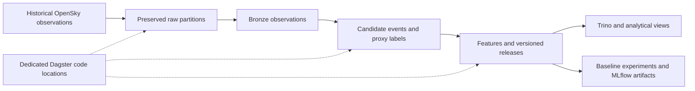

<!-- [房玄龄·2026-11-04] Owner-approved platform positioning; documentation only. -->

# Aviation workload: historical observations to inspectable datasets

## Scope and implementation boundary

Aviation is the primary domain of the personally operated platform. A separately maintained pipeline processes historical OpenSky observations around Frankfurt Airport into candidate arrival events, taxi-in proxy labels, features, baseline experiments, and analytical outputs.

This public repository supplies the platform foundation and finance reference code. It does not contain the aviation acquisition, event-detection, or automation implementation. Aviation source code and detailed operational records remain private; cloning SoloLakehouse alone does not reproduce this workflow. No private repository links, credentials, aircraft identifiers, or raw trajectories are required to read this guide.

## Workflow in the operated environment

The workflow reuses MinIO, Iceberg/catalog, Trino, Dagster, and MLflow services. Aviation workers, data namespaces, and processing state are scoped separately from finance. This is workload separation on shared infrastructure, not separate physical failure domains. The operated environment uses Metabase and Evidence for analytical views; the repository's reference Compose runtime includes Superset instead. OpenMetadata is paused in the operated environment, so its historical lineage capability is not claimed as continuously active there.

## Operator-reported snapshot: 2026-11-04

The following is a sanitized summary of read-only operator checks and retained private acceptance reports. It is not an independently reproducible benchmark or a current health endpoint. No new acquisition, training, or repair was performed to write this page.

| Measure | Reported scope and result |
|---|---|
| Latest processed cohort | 33 days, 2026-10-01 through 2026-11-02 |
| Candidate events | 12,444 |
| Proxy-labelled feature rows | 7,751 |
| Unavailable targets | 4,693; zero pending in that snapshot |
| Airport-validated labels | 0 |
| Prior successful cycle | 2026-11-03: acquisition, processing, quality, experiment, artifact-readback, and dashboard acknowledgements completed |
| No-new-data rerun | 2026-11-03: ten checked table snapshot IDs and eight model-run IDs unchanged; run audit records still added |
| Latest scheduled cycle at check time | 2026-11-04 05:15 Europe/Berlin: acquisition failed with `AUTH_REQUIRED`; processed data remained at November 2 |

The successful cycle and idempotency checks describe their specific scope. They do not prove unattended source authentication, host-loss recovery, online prediction, browser visual acceptance, or external adoption. The authentication failure was unresolved at the snapshot.

## A separate 32-day quality diagnostic

The earlier diagnostic covers 2026-10-01 through 2026-11-01, including an observation tail. It contains 27,376,674 Bronze rows, 12,251 candidate events, 7,694 proxy labels, and 4,557 unavailable targets. These totals belong to that diagnostic batch, not the later 33-day operating view.

Of its proxy labels, 2,019 had brief stationary-position evidence near the final observed apron position. The other 5,675 used the last observed apron endpoint without that additional stopping evidence. Both groups remain proxies; neither establishes a verified final arrival-at-stand time.

Declining ground-observation coverage accompanied fewer detected events and available labels. These observations do not establish a decline in real airport traffic or identify a particular receiver failure. Map coverage, stale ground records, observation gaps, and right-censoring affect the meaning of the outputs.

## Uses and limitations

The available evidence supports discussion of ingestion, versioned processing, data conservation, missingness, proxy-label definitions, experimental reproducibility, and operational dependencies. It does not establish airport event recall, real taxi-in prediction accuracy, seasonal or cross-airport generalization, distributed throughput, or operational business benefit.

The model experiments are historical proxy experiments. Reloading an artifact and obtaining the same predictions checks artifact handling, not the truth of its targets. A prediction-effectiveness claim needs independently matched ground truth and an appropriate evaluation design.

## Next evidence to assemble

The near-term case should make the architecture, source/label definitions, successful runs, quality findings, failures, and recovery limits reviewable together. Source authentication and scheduled freshness remain operating dependencies. Independent reproduction, longer-term operating evidence, costs, and host-loss recovery need separate checks. Any label-rule revision or ground-truth acquisition should be versioned and evaluated without overwriting the existing evidence.

See [the platform story](../platform-overview.md), [architecture](../architecture.md), and [current execution order](../../TASKS.md).
