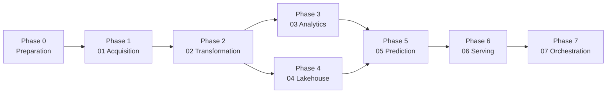

# Project plan

Plan for the Fraport OpenSky Intelligence programme. Durations are rough
estimates for one person working part-time. Replace them with measured
values after the first phase.

## Overview

| Phase | Subproject | Runtime | Estimate |
|-------|------------|---------|----------|
| 0 | Preparation | Local | 1 week |
| 1 | 01 OpenSky Acquisition | Local + GCS | 4 to 6 weeks |
| 2 | 02 Aviation Transformation | GCP | 4 to 5 weeks |
| 3 | 03 Airport Analytics | BigQuery | 2 to 3 weeks |
| 4 | 04 Lakehouse Integration | Databricks | 3 to 4 weeks |
| 5 | 05 Taxi-in Prediction | Vertex AI | 4 to 5 weeks |
| 6 | 06 Model Serving | Cloud Run | 2 to 3 weeks |
| 7 | 07 Orchestration | GCP Workflows or Dagster | 3 to 4 weeks |

Phases 3 and 4 can run in parallel after phase 2.

## Phase 0: Preparation

- Confirm OpenSky account, Trino access and query limits.
- Read the OpenSky terms on retention and cloud storage. Record the result.
- Decide the geographic bounds and fields for dataset `v1`.
- Accept ADR-001.
- Create the data root outside the repository and check free disk space.
- Add the `.gitignore` rules that keep data and credentials out of Git.

**Exit:** access confirmed, terms understood, ADR accepted.

## Phase 1: 01 OpenSky Acquisition

Scope: dataset `eddf_r75km` v1, 75 km region, `[2024-11-01, 2026-11-01)`,
24 monthly batches. See the [design](../01-opensky-acquisition/docs/design.md)
and the [batch plan](../01-opensky-acquisition/docs/batch-plan.md).

| Milestone | Content | Exit criterion |
|-----------|---------|----------------|
| M0 | Skeleton: config, schema, manifest, state, fake client, CLI shell | Unit tests pass |
| M1 | Collect and commit protocol against the fake client | Crash-injection and repeat-run tests pass |
| M2 | Live pilot: one hour, one day, one week | Gate G0: reconciled, cross-checked, measured, recovery tested |
| M3 | Monthly batches with reports, acceptance and backup | Each batch accepted and backed up |
| M4 | GCS upload, manifest export, DuckDB catalog | Upload verified, after OpenSky confirmation |
| M5 | Dataset sign-off | Full verify, dataset summary, restore tested |

CI: tests and lint on pull requests that touch this directory.
GCS upload waits for the licensing check.

## Phase 2: 02 Aviation Transformation

1. Local Silver transform for one day, with tests.
2. Container and one Cloud Run Job run.
3. GitHub to Artifact Registry to Cloud Run pipeline.
4. Full-year run with run ID, quality report and repeat-run result.
5. Engine comparison (Polars, Spark, BigQuery SQL).

**Exit:** reproducible Silver output and a working release pipeline.

## Phase 3: 03 Airport Analytics

1. Load one month and document the model.
2. Core queries with expected results.
3. Full year, cost record and findings.

**Exit:** reconciled tables, documented grain and a findings report.

## Phase 4: 04 Lakehouse Integration

1. Schema mapping and GCS access from Databricks.
2. One month through Bronze, Silver and Gold.
3. Feature contract with project 05.

**Exit:** reproducible Gold features with reported label coverage.

## Phase 5: 05 Taxi-in Prediction

1. Label definition and coverage.
2. Baselines on a time-ordered split.
3. Gradient-boosted model with experiment tracking.
4. Vertex AI training job and model registration.
5. Evaluation report.

**Exit:** versioned model and an honest comparison against the baseline.

## Phase 6: 06 Model Serving

1. Contract tests with synthetic requests.
2. Local container with a pinned model version.
3. Cloud Run deployment through CI/CD.
4. Monitoring and a tested rollback.

**Exit:** deployed endpoint traceable to a model version and commit.

## Phase 7: 07 Platform Orchestration

1. ADR comparing Workflows and Dagster.
2. Orchestrate transformation and analytics.
3. Add features and training.
4. Failure injection and recovery runbook.

**Exit:** a failed stage reruns without redoing earlier stages.

## Cross-cutting work

- **CI.** Each subproject has its own path-scoped checks.
- **Documentation.** Each subproject keeps its README current, adds
  architecture and runbook pages when needed and records decisions as ADRs.
- **Evidence.** Record commit, run ID, data version and quality results for
  each milestone.
- **Cost.** Track observed cloud cost from phase 2 onward.
- **Data governance.** Keep raw data out of Git. Review licensing before
  any publication.

## Risks

| Risk | Impact | Mitigation |
|------|--------|------------|
| OpenSky Trino limits or downtime | Slow or incomplete backfill | Hourly batches, retries, resumable checkpoint |
| OpenSky terms restrict retention or cloud copies | Cannot store data in GCS | Check in phase 0, keep local backup, use synthetic data publicly |
| Data volume above estimate | Disk shortage | Seven-day size test before the full backfill |
| Proxy labels are noisy | Weak model or overclaimed results | Report coverage, validate a sample independently |
| Scope growth | Programme stalls | Finish each phase exit criterion before starting the next |
| Overlap with existing aviation projects | Duplicate work | Subprojects 04 and 06 link to them and own only integration |

## Open decisions

- Final geographic bounds and the field list for `v1`.
- Whether GCS upload is allowed under the OpenSky terms.
- Cloud Run Jobs or Dataproc Serverless for phase 2.
- GCP Workflows or Dagster for phase 7.
- Whether this directory should stay under `gcp/` or move, since project 01
  runs locally.
